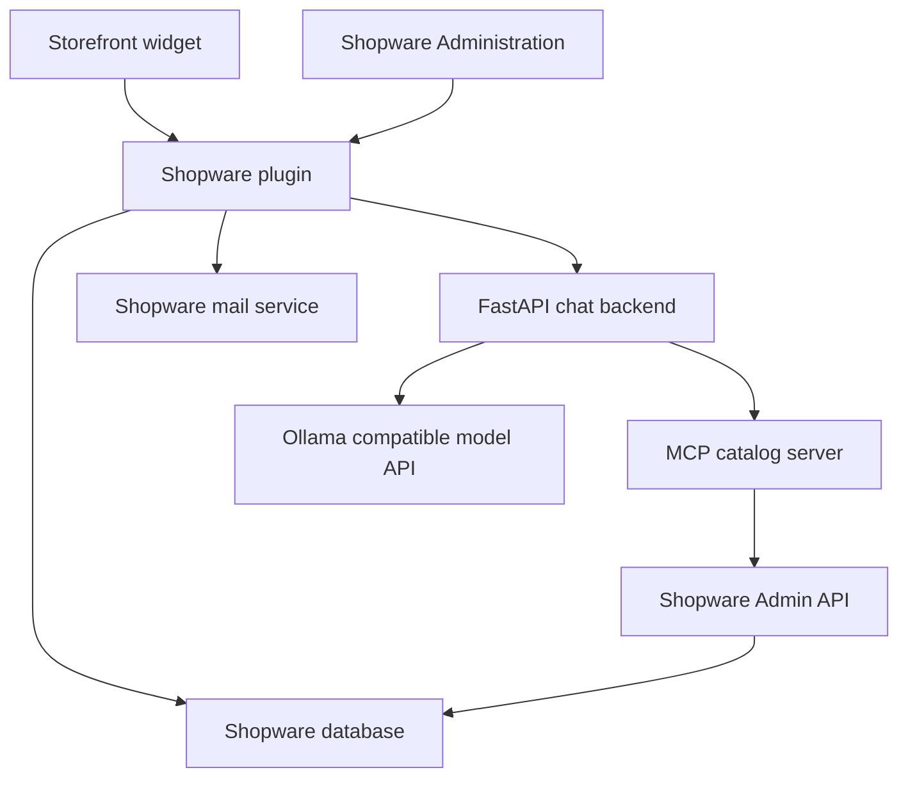
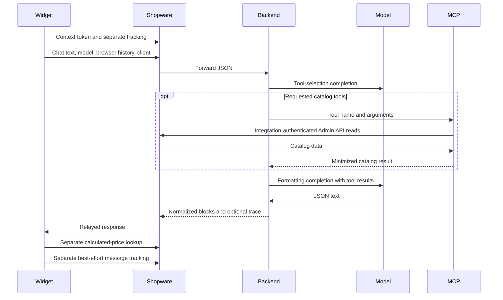
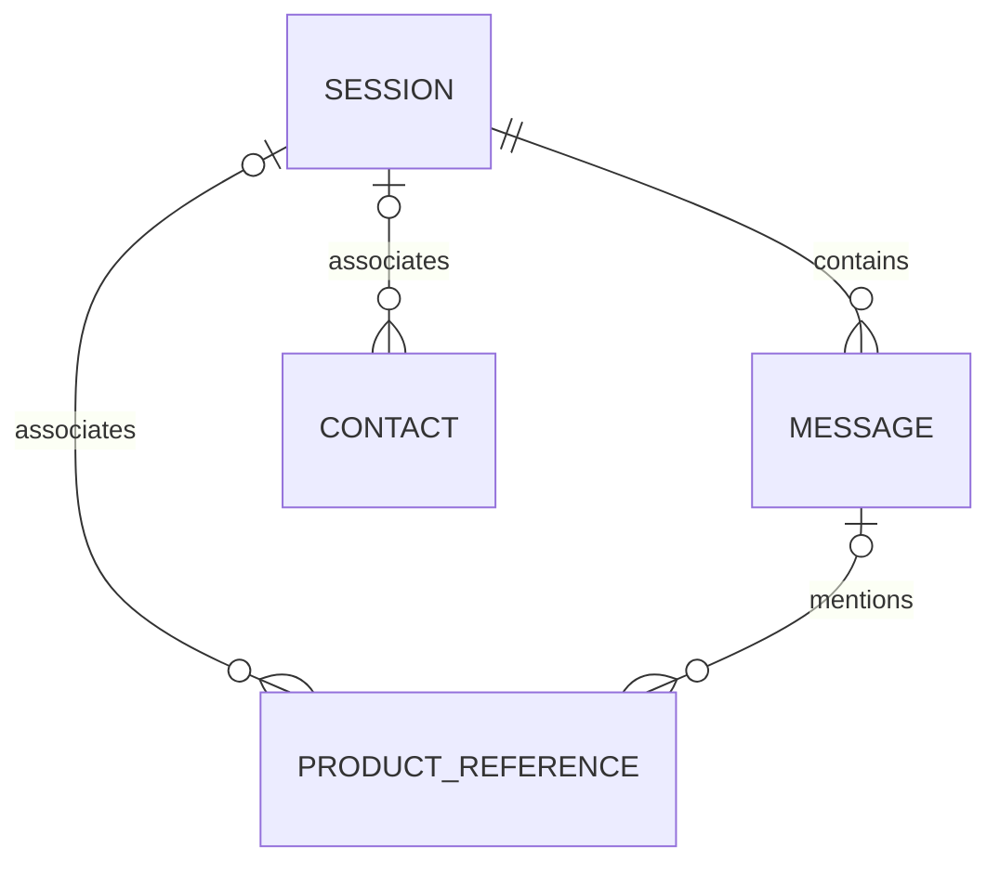

# Current architecture — AICA as one system

Audit date: 2026-09-02. This document describes observed source, not the proposed rework. Production code was not changed. Read with [findings](ARCHITECTURE_AUDIT.md), [evidence and limitations](AUDIT_EVIDENCE.md), and [target architecture](TARGET_ARCHITECTURE.md).

## Baseline and scope

| Repository | Default branch audited | Supplemental branch |
| --- | --- | --- |
| `astrotmo/AiCommerceAssistant` (A) | `main` at `78581facc8470eef3e85ef667339693616c63cc7` | `stage` at `0555666efe2b94799c7b59dd9a950f6cda292c78` |
| `astrotmo/shopware-ai-chat-backend` (B) | `main` at `fe72dd4af104cef5eaf61104fa73779f0bf7870b` | `stage` at `604bb5a9c8b5d1e1b3b40d96e108aae2af061a30` |

Both main trees were obtained in full: 79 tracked text files in A and 31 in B. Stage differences were also read. They add explanations and comments; they do not introduce an alternative architecture. Source links below pin the audited main commits. Current deployments, ignored files, database contents, other plugins, and actual infrastructure are outside the observed evidence.

## Component and deployment map

This is a distributed application with split context: customer-aware prices and persistence are in Shopware, while product discovery goes through a different, integration-authenticated Admin API path. The browser supplies conversation history. The backend has no durable conversation store.

| Area | Actual implementation and responsibility |
| --- | --- |
| Plugin package | [`A:composer.json`](https://github.com/astrotmo/AiCommerceAssistant/blob/78581facc8470eef3e85ef667339693616c63cc7/composer.json); platform plugin `custom/ai-commerce-assistant`, version 1.0.0, `shopware/core ~6.7.0`. PHP and Storefront dependencies are implicit in the host Shopware project. |
| Lifecycle | [`A:src/AiCommerceAssistant.php`](https://github.com/astrotmo/AiCommerceAssistant/blob/78581facc8470eef3e85ef667339693616c63cc7/src/AiCommerceAssistant.php); install/update create contact mail templates; activate/deactivate are placeholders. `uninstall(keepUserData=false)` has a cleanup TODO. Migration is a separate Shopware mechanism. |
| Dependency injection | [`A:src/Resources/config/services.xml`](https://github.com/astrotmo/AiCommerceAssistant/blob/78581facc8470eef3e85ef667339693616c63cc7/src/Resources/config/services.xml); four DAL definitions, session resolver, tracking, analytics, template setup, mail service, subscriber, five storefront controllers and one admin controller. Context signing requires `CHAT_AUTH_SECRET`; hashing uses the kernel secret. |
| Routes | [`A:src/Resources/config/routes.xml`](https://github.com/astrotmo/AiCommerceAssistant/blob/78581facc8470eef3e85ef667339693616c63cc7/src/Resources/config/routes.xml) imports the controllers; their route attributes define scope and permissions. |
| Storefront | [`A:src/Resources/app/storefront/src/plugin/aica.plugin.js`](https://github.com/astrotmo/AiCommerceAssistant/blob/78581facc8470eef3e85ef667339693616c63cc7/src/Resources/app/storefront/src/plugin/aica.plugin.js); one 1,635-line class owns state, DOM, network, rendering, forms, prices, history and tracking. Registered from [`A:src/Resources/app/storefront/src/main.js`](https://github.com/astrotmo/AiCommerceAssistant/blob/78581facc8470eef3e85ef667339693616c63cc7/src/Resources/app/storefront/src/main.js). |
| Mount and context | [`A:src/Resources/views/storefront/page/content/index.html.twig`](https://github.com/astrotmo/AiCommerceAssistant/blob/78581facc8470eef3e85ef667339693616c63cc7/src/Resources/views/storefront/page/content/index.html.twig) overrides `base_main_inner`; [`A:src/Subscriber/StorefrontSubscriber.php`](https://github.com/astrotmo/AiCommerceAssistant/blob/78581facc8470eef3e85ef667339693616c63cc7/src/Subscriber/StorefrontSubscriber.php) subscribes to page loading. Template and subscriber duplicate some configuration/default handling. This mount does not establish coverage of every Shopware page or theme. |
| Administration | [`A:src/Resources/app/administration/src/module/aica/index.js`](https://github.com/astrotmo/AiCommerceAssistant/blob/78581facc8470eef3e85ef667339693616c63cc7/src/Resources/app/administration/src/module/aica/index.js); dashboard, session list/detail, contact list/detail, DAL repositories, custom dashboard API, rendered-message component, DE/EN snippets, extension configuration help. |
| Backend entry point | [`B:app.py`](https://github.com/astrotmo/shopware-ai-chat-backend/blob/fe72dd4af104cef5eaf61104fa73779f0bf7870b/app.py); global configuration, prompts, schemas, sync OpenAI client, domain resolver, MCP cache, FastAPI routes, tracing and orchestration in one 1,377-line module. `main.py` is an unused greeting entry point. |
| Model runtime | [`B:compose.yaml`](https://github.com/astrotmo/shopware-ai-chat-backend/blob/fe72dd4af104cef5eaf61104fa73779f0bf7870b/compose.yaml); Ollama plus Python chat and MCP containers. Runtime model names, aliases and context settings are resolved in `app.py`; transport is OpenAI-compatible Chat Completions. |
| Catalog gateway | [`B:shopware_mcp_server.py`](https://github.com/astrotmo/shopware-ai-chat-backend/blob/fe72dd4af104cef5eaf61104fa73779f0bf7870b/shopware_mcp_server.py); FastMCP, four read-only tools, Admin API OAuth client credentials and token cache. No cart, order or customer mutation tool exists. |
| Domain knowledge | [`B:backend/app/services/domain_knowledge_resolver.py`](https://github.com/astrotmo/shopware-ai-chat-backend/blob/fe72dd4af104cef5eaf61104fa73779f0bf7870b/backend/app/services/domain_knowledge_resolver.py), loader, models, prompt builder and [`B:backend/data/domain_terms.json`](https://github.com/astrotmo/shopware-ai-chat-backend/blob/fe72dd4af104cef5eaf61104fa73779f0bf7870b/backend/data/domain_terms.json); deterministic curated vocabulary, not vector retrieval. |

No scheduled tasks, retention workers, custom public extension events, vector database, embeddings, reranker, agent framework, durable job queue, or backend conversation database are present in these trees.

## Public and internal interfaces

| Interface | Input/output and actual enforcement |
| --- | --- |
| `POST /aica/chat` | [`A:src/Storefront/Controller/ChatProxyController.php`](https://github.com/astrotmo/AiCommerceAssistant/blob/78581facc8470eef3e85ef667339693616c63cc7/src/Storefront/Controller/ChatProxyController.php) accepts JSON arrays/objects, forwards the payload to configured HTTP(S) backend, relays response status/body/content type. `X-AICA-Proxy: 1` is an identification marker. No service credential or server-owned context is injected. 60-second timeout/max duration; 502/504 transport errors. |
| `GET /aica/context-token` | [`A:src/Storefront/Controller/ChatContextController.php`](https://github.com/astrotmo/AiCommerceAssistant/blob/78581facc8470eef3e85ef667339693616c63cc7/src/Storefront/Controller/ChatContextController.php) requires AJAX marker headers and issues a 60-second HS256 token: `sid`, `salesChannelId`, `iat`, `exp`, `jti`. No customer ID or authenticated-customer claim. Response is `no-store`; session touch is best effort. |
| `POST /aica/prices` | [`A:src/Storefront/Controller/PricesController.php`](https://github.com/astrotmo/AiCommerceAssistant/blob/78581facc8470eef3e85ef667339693616c63cc7/src/Storefront/Controller/PricesController.php) accepts up to 50 valid UUIDs. AJAX markers, visibility policy and real `SalesChannelContext`; SalesChannel product repository calculates prices. |
| `POST /aica/track` | [`A:src/Storefront/Controller/ChatTrackingController.php`](https://github.com/astrotmo/AiCommerceAssistant/blob/78581facc8470eef3e85ef667339693616c63cc7/src/Storefront/Controller/ChatTrackingController.php) accepts browser `message` and `contact_form_shown` events. AJAX markers, no dedicated rate or body-size limit. |
| `POST /aica/contact` | [`A:src/Storefront/Controller/FormularController.php`](https://github.com/astrotmo/AiCommerceAssistant/blob/78581facc8470eef3e85ef667339693616c63cc7/src/Storefront/Controller/FormularController.php) accepts JSON/form data, checks honeypot, email, message and field lengths, applies Shopware contact limiter, sends mail and attempts persistence. |
| Admin dashboard actions | [`A:src/Controller/Api/ChatAnalyticsController.php`](https://github.com/astrotmo/AiCommerceAssistant/blob/78581facc8470eef3e85ef667339693616c63cc7/src/Controller/Api/ChatAnalyticsController.php); six `POST /api/_action/aica/dashboard/...` actions: overview, three CSV exports and two date-range deletions. API route scope and explicit `_acl` are present. Other lists/detail views use normal DAL APIs. |
| `POST /chat` | [`B:app.py`](https://github.com/astrotmo/shopware-ai-chat-backend/blob/fe72dd4af104cef5eaf61104fa73779f0bf7870b/app.py) `ChatIn` requires `message: str`, `model: str`; optional `history: list[dict]`, `client: dict`; extra fields ignored. No route authentication, model allowlist, request budget, length/count limits or declared success response model. `client.contextToken` is deliberately ignored. |
| `GET /healthz` | Reports process/configuration state, not dependency readiness. |
| `GET /trace/{request_id}` | If tracing is enabled, returns process-local traces without authentication. |
| MCP `/mcp` | Streamable HTTP catalog tools; no application authentication configured by this repository. SDK transport protection and deployment network restrictions are distinct from authentication. |

Browser headers that make a request non-simple can contribute to CSRF protection, but are not credentials: a direct HTTP client can supply them. CORS is not service authentication either. The backend defaults to a permissive HTTP(S) origin regex with credentials enabled.

The JSON reply contract is implicit: `type` is `answer`, `clarification` or `error`; `blocks` supports `text`, `product_list`, `info_box`, and misspelled legacy `formular`. `request_id` and optional trace fields vary by path, including dry-run. Product objects can carry model-produced ID, name, number, purchase unit, unit and price. There is no shared versioned schema. `normalize_chat_reply` and `normalize_blocks` are permissive adapters, not complete validators.

## Chat and product flow

Observed details in [`B:app.py`](https://github.com/astrotmo/shopware-ai-chat-backend/blob/fe72dd4af104cef5eaf61104fa73779f0bf7870b/app.py), `chat` and `chat_with_tools`:

1. Clean expired trace entries; accept header request ID or generate `time_ns` string.
2. Resolve curated domain terms synchronously; add their system prompt block.
3. Accept user/assistant strings from supplied browser history; strip other roles, but do not verify assistant content or enforce a server context budget.
4. Select runtime model from the caller's model string and environment aliases.
5. Call synchronous `client.chat.completions.create` from the async route. The nominal eight-iteration loop always breaks after one tool-selection round. Successful ordinary requests make two completions even without a tool call.
6. Execute requested tools sequentially. The assistant message containing `tool_calls` is not appended before tool-role results.
7. Replace the first system prompt with a format prompt, then request JSON-object output. This is not JSON Schema-constrained generation.
8. Store optional traces, normalize the JSON and return. Invalid nested values can raise; non-JSON text can fall back to a text block.

Tool declarations in `TOOLS_PUBLIC` and MCP Python function signatures are maintained separately. The tools search products, get a product, find products by number and list categories. Category options and some limits are not equally represented in the public schema. MCP result decoding does not preserve `isError` or structured result metadata.

Catalog reads use Admin API criteria without sales-channel availability/search visibility filters. Locale parameters are accepted but not applied to Shopware requests. Returned products deliberately omit prices and stock. That field minimization is useful, but it does not make discovery storefront-authorized. Categories are requested as `product_list` in the prompt, so the widget builds product-detail links for category IDs.

## Price authority and rendering

| Concern | Actual source and limitation |
| --- | --- |
| Customer, sales channel and currency rules | Shopware calculates the `/aica/prices` response using `SalesChannelContext`. MCP is not involved in this calculation. |
| Gross/net numeric calculation | Inherited from Shopware calculated prices; the response does not explicitly serialize tax state for correct presentation. |
| Currency | ISO code from context with EUR fallback. Currency precision and rounding metadata are not transported. |
| Sale unit price / total | `calculatedPrice.unitPrice` and `totalPrice`, plus list/regulation price data. |
| Quantity tiers | `calculatedPrices` contains `quantity` and unit/total prices. No requested quantity is accepted. `advanced-first` UI prefers quantity 1 or otherwise the first available tier. |
| Reference price per measure | Shopware's `referencePrice` is not included; purchase unit text does not replace it. |
| Initial displayed identity and price | Model-produced product blocks are rendered first. A failed or missing later lookup leaves the model price in place. Returned authoritative product names do not replace model names. |
| Visibility | `none`, `all`, `customers`. UI excludes guest-checkout customers; controller only checks `getCustomer() !== null`, so policy differs. |

The source of price numbers and the selection of which number to display are separate responsibilities today. A browser probe selected a quantity-10 price of 7 over a base price of 10 without quantity 10 being requested. A normalizer probe retained the string `0.01 EUR` for an invented product. Therefore “Shopware has the price endpoint” is insufficient to claim end-to-end deterministic pricing. See [`A:src/Resources/app/storefront/src/plugin/aica.plugin.js`](https://github.com/astrotmo/AiCommerceAssistant/blob/78581facc8470eef3e85ef667339693616c63cc7/src/Resources/app/storefront/src/plugin/aica.plugin.js), `renderProductList`, `resolveProductPrice`, `fetchCalculatedPrices`.

## Conversation and persistence

| State | Owner, lifetime and trust |
| --- | --- |
| Display history | Browser `sessionStorage` keys `aica-history` and `aica-open`, same origin/tab, up to 60 messages, no application TTL or principal/channel namespace. |
| Model history | Browser-derived subset: up to 12 entries, 1,200 characters each, total 8,000 characters. These are client controls only. Backend is stateless between requests. |
| Request queue | Browser promise chain, maximum five queued requests, input limit 2,000 characters. History is captured at submit time, before earlier queued answers finish. |
| Session identifier | [`A:src/Service/ChatSessionResolver.php`](https://github.com/astrotmo/AiCommerceAssistant/blob/78581facc8470eef3e85ef667339693616c63cc7/src/Service/ChatSessionResolver.php); session key `aica.session_id`, random 16 bytes; fallback hash of context token. No explicit ownership rotation on login/logout or channel change. |
| Persisted conversation | [`A:src/Service/ChatTrackingService.php`](https://github.com/astrotmo/AiCommerceAssistant/blob/78581facc8470eef3e85ef667339693616c63cc7/src/Service/ChatTrackingService.php); browser-reported analytics messages, not a server-recorded authoritative transcript. Client message indices and roles are accepted. |
| Backend state | Global model client, lazy shared MCP session, domain indexes and trace maps, all process-local. No recovery of an in-flight request after restart. |

The database migration [`A:src/Migration/Migration1781000000CreateAicaPersistence.php`](https://github.com/astrotmo/AiCommerceAssistant/blob/78581facc8470eef3e85ef667339693616c63cc7/src/Migration/Migration1781000000CreateAicaPersistence.php) creates:

`aica_chat_session` has a unique storefront identifier, nullable customer/channel/language links, timestamps, aggregates and diagnostic fields. `aica_chat_message` has a unique `(session_id, message_index)`, text, rendered payload, usage and optional debug payload. `aica_contact_submission` holds personal/contact data, message and mail statuses. `aica_product_reference` stores a free-form product ID, source and optional message/session associations; it has neither a real product foreign key nor a contact-submission foreign key.

Customer/channel/language deletion uses nullable associations. Message deletion cascades with session deletion; contacts survive session deletion with null session. Custom session-range deletion also clears references; contact deletion does not clear associated reference/aggregate effects. These semantics do not constitute a complete personal-data erasure policy.

Tracking writes are separate from chat execution and are not atomic with it. Message insertion, product references and read-modify-write aggregates can partially succeed. On reload the widget resets the next index from the capped local array length: after more than 60 messages, it can reuse an existing server index. Missing/null customer fields are not reliably cleared on session updates, so identity transitions can retain earlier associations.

## Contact and analytics flows

Contact: widget-generated `formular` → `/aica/contact` validation → session touch → internal email → optional confirmation → best-effort DAL persistence → HTTP success. Failures can be returned as additional mail-status fields, but the widget only treats HTTP failure as failure. A handled mail failure combined with swallowed persistence failure can therefore report success without a saved lead. Quantity and delivery ZIP are used in mail data but not persisted in the contact entity. The dynamic form schema can omit mandatory server fields. Mail lookup exceptions outside guarded send code can instead produce an HTTP error.

Mail templates are created by [`A:src/Setup/ContactMailTemplateSetup.php`](https://github.com/astrotmo/AiCommerceAssistant/blob/78581facc8470eef3e85ef667339693616c63cc7/src/Setup/ContactMailTemplateSetup.php); existing templates are preserved. [`A:src/Service/ContactSubmissionMailService.php`](https://github.com/astrotmo/AiCommerceAssistant/blob/78581facc8470eef3e85ef667339693616c63cc7/src/Service/ContactSubmissionMailService.php) uses Shopware mail delivery, with per-channel recipient and platform email fallbacks. No external CRM dependency was found.

Analytics: browser events → storefront controller → tracking service → four DAL entities → DAL Administration lists/details and SQL dashboard/export service. Roles, token counts, latency, model names and product references are partly client claims. Message text and rendered blocks persist even with raw debug capture off. Raw IP/debug capture depends on settings; disabling capture does not erase previously stored data.

The dashboard has real API ACLs. However, `canViewDebugData` only controls UI visibility: debug fields are API-aware on the same entities read by ordinary viewers. Lists search message text through a first-200-message prequery; details fetch all related pages. Date-filter semantics differ between overview/export and session deletion. CSV escaping uses `fputcsv`, without spreadsheet-formula neutralization.

## Configuration, deployment and operations

[`A:src/Resources/config/config.xml`](https://github.com/astrotmo/AiCommerceAssistant/blob/78581facc8470eef3e85ef667339693616c63cc7/src/Resources/config/config.xml) contains backend/model, widget, price visibility/mode, mail and debug/privacy settings under `AiCommerceAssistant.config.*`. Most are channel-aware. Model defaults differ between XML and subscriber. Storefront text remains substantially German despite Administration DE/EN snippets.

[`B:pyproject.toml`](https://github.com/astrotmo/shopware-ai-chat-backend/blob/fe72dd4af104cef5eaf61104fa73779f0bf7870b/pyproject.toml) declares Python >=3.10; [`B:Dockerfile`](https://github.com/astrotmo/shopware-ai-chat-backend/blob/fe72dd4af104cef5eaf61104fa73779f0bf7870b/Dockerfile) uses Python 3.12, locked `uv` installation and a non-root user. `uv.lock` resolves FastAPI 0.121.1, Starlette 0.49.3, Uvicorn 0.38.0, OpenAI 2.7.1, MCP 1.21.0 and HTTPX 0.28.1. These are observed dependency versions, not a vulnerability assessment or recommended upgrades.

Compose publishes chat 8002, MCP 8005 and Ollama 11434 on host interfaces, requires NVIDIA GPU devices, mounts `/mnt/e/llm-work/gguf`, bind-mounts source, enables Ollama debugging and pins an Ollama release candidate. `depends_on` supplies startup order without health/readiness checks. [`B:Makefile`](https://github.com/astrotmo/shopware-ai-chat-backend/blob/fe72dd4af104cef5eaf61104fa73779f0bf7870b/Makefile) uses `.env.local` for Compose interpolation while services inject `.env`; `load_dotenv()` also reads `.env`. The tracked `.env.local` contains empty Shopware credentials and an empty chat secret in this snapshot; no usable leaked credential was established. Docker excludes `.env` but not `.env.local`, which is a future packaging risk.

The proxy stops waiting after 60 seconds. The pinned OpenAI client's untouched defaults allow a much longer request and retries. MCP's Shopware calls use 10-second OAuth and 15-second HTTP timeouts. No coherent end-to-end deadline, admission limit or browser-disconnect propagation exists. Raw user text is logged at INFO; debug mode can log full messages/results. Trace maps use lazy TTL cleanup but no size cap.

## External and legacy coupling

| Observable interface | Classification | Consequence |
| --- | --- | --- |
| Shopware DI, DAL, SalesChannel prices, mail, Twig, Administration, Symfony HTTP client | Generic Shopware dependency | Keep platform integration and test against supported 6.7 releases. |
| Fixed HTTP JSON contract between A and B; duplicate schemas | Hard coupling | Both repositories must move through a tested contract release. |
| MCP server + Admin API integration credentials | Hard coupling today | Required for current catalog tools, optional in the target. |
| `base_main_inner` in content page, origin-root URLs | Accidental theme/deployment coupling | Other themes and base paths need explicit compatibility testing. |
| Bakery/domain prompts and vocabulary; pricing-to-contact assumptions | Legacy project-specific behavior | Extract optional domain/policy configuration. |
| `/paul-ai-chat/contact` in backend prompt | Legacy project-specific behavior | Normalization drops the supplied action today; no executable dependency on that route is established. |
| Alternate FastMCP import, dictionary/text/JSON result parsing, model aliases | Compatibility layers | Remove obsolete parsing after defining a supported matrix; keep runtime-specific alias handling inside provider configuration. |
| `docs/text*.txt` shop notes and examples | Historical context | Not loaded as runtime RAG; do not treat as generic product requirements. |

No code dependency on another named custom plugin was found. Other repositories and live theme overrides were unavailable, so absence of externally implemented consumers cannot be established.
