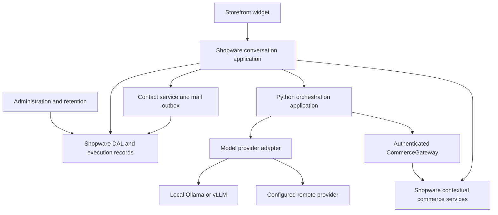
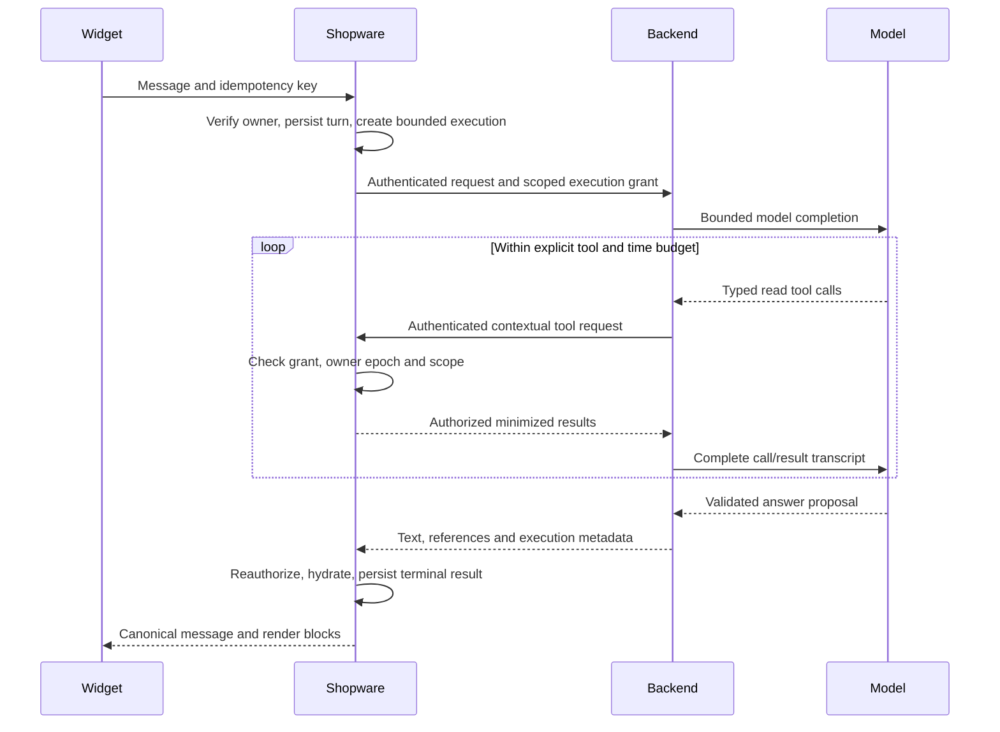
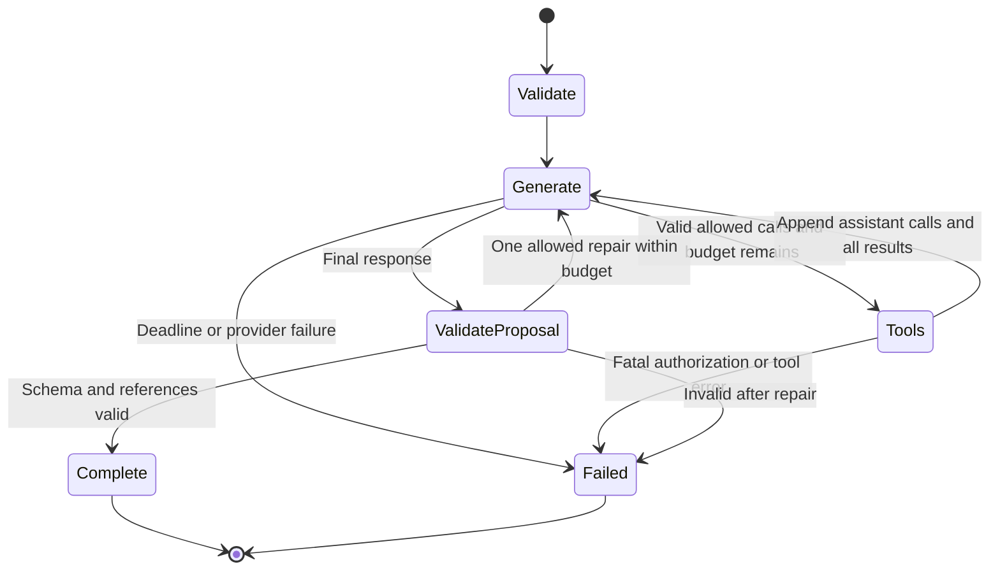

# Target architecture — contextual commerce, bounded model work

Status: **proposed, not implemented**. Date: 2026-09-02. Based on [current architecture](CURRENT_ARCHITECTURE.md), [findings](ARCHITECTURE_AUDIT.md) and [research](ARCHITECTURE_RESEARCH.md). Decisions and tradeoffs are in [ADRs](ARCHITECTURE_DECISIONS.md); breaking changes and gates are in [rework plan](REWORK_PLAN.md).

## Product boundary and principles

Keep one Shopware plugin and one modular Python backend. Keep the model runtime independently deployable so a local installation can run Shopware + AICA + backend + Ollama with no cloud inference. A remote backend or model is explicit operator configuration; failures never silently move customer data to a cloud fallback.

Shopware owns identity, conversation durability, catalog permissions, pricing, contacts and administration. The backend owns context assembly, bounded orchestration, model-provider adaptation and optional domain enrichment. The model proposes text and references. Deterministic Shopware services authorize and produce every commerce object displayed to the customer.

MCP leaves the obligatory catalog path. A small internal tool registry calls a typed Shopware CommerceGateway. An optional MCP adapter can later expose the same authorized tools to real external consumers. No additional microservices, mandatory vector database, agent framework, Redis or second conversation database are required.

Remote and local model edges are deployment alternatives; only configured profiles are available. The diagram does not imply using both for each request.

## Components and dependency direction

| Component | Responsibility | Dependencies and exclusions |
| --- | --- | --- |
| Storefront adapter | Mount, input, visible state, abort, typed blocks, accessibility | Talks only to same-origin Shopware routes. Does not choose raw model IDs or serialize authoritative history. |
| Conversation application | Authenticate current principal, create/resume conversation, accept ordered turns, acquire execution lease, persist outcomes | DAL, backend client, result presenter; no provider SDK. |
| Commerce services | Search/detail/category access, variants, availability, price presentation and generated links | Real SalesChannelContext and Shopware routes/decorators; no prompt or LLM dependency. |
| CommerceGateway HTTP adapter | Validate backend credential, execution capability, scope and arguments; call commerce ports | Cannot accept arbitrary URLs, credentials or client-declared customer IDs. |
| Contact service | Fixed form schema, validation, durable accepted state, delivery retries | Shopware mail/Messenger; no autonomous model submission. |
| Backend ChatService | Bounded conversation context, tool selection, typed final answer proposal | ModelPort, ToolRegistry, CommerceGateway client, optional DomainKnowledgeProvider, telemetry. |
| ModelPort | Minimal async completion/tool/structured-output contract and capability reporting | Provider-specific adapters contain SDK types, runtime aliases and quirks. |
| ToolRegistry | Explicit name, input/output schema, read scope, limit, timeout and handler | Authorized CommerceGateway or approved local read-only domain functions. |
| Response validator/presenter | Backend validates proposals; Shopware hydrates authorized references into final render DTOs | Rejects unknown IDs/blocks and model-generated commerce fields. |
| Administration | Canonical records, contact delivery state, pagination, exports and protected diagnostics | Server ACLs and purpose-specific data access. |

Within Python, application services depend on small ports rather than FastAPI request objects or SDK clients. HTTP routes adapt DTOs/errors to the application. Within PHP, controllers delegate to application services, which call abstract/decoratable commerce services and DAL repositories. Avoid interfaces for every trivial function; add them where replacement or independent boundary tests have concrete value.

Suggested module boundaries, not a requirement to implement all files immediately:

| Repository | Modules |
| --- | --- |
| A | `Conversation`, `Commerce`, `Contact`, `Telemetry`, `Administration`, `Integration/Backend`, thin Storefront/API controllers, existing DAL migration system |
| B | `api`, `contracts`, `application/chat`, `orchestration`, `providers`, `tools`, `integrations/shopware`, `domain_knowledge`, `observability`, `settings` |

## End-to-end execution and context security

1. The browser carries normal Shopware session context and an opaque conversation ID. The ID alone never grants access. It submits new text, optional explicit product-page context IDs and an idempotency key; Shopware verifies any page references.
2. Shopware derives channel, language, currency, customer/guest status and a **principal epoch** from server state. Account/logout/channel changes invalidate the prior epoch. Customer identity is not copied from the browser request body.
3. In a short transaction, accept the user turn, allocate its sequence, create an execution record and acquire one active execution lease. Commit before network IO; do not hold a DB transaction or PHP session lock across inference.
4. Shopware sends the trusted bounded transcript and a short-lived random opaque execution grant to the configured backend. Store only a hash of the grant with execution ID, owner epoch, server-held context-token reference, allowed read scopes, expiration and terminal/cancel state. Never send customer session cookies or Admin API credentials to the model.
5. Backend and callback endpoints require **distinct installation service credentials**, rotated and stored outside public config. TLS is required outside an explicitly trusted same-host/private environment. An opaque grant supplements service authentication; neither substitutes for the other. Rate-limit grant issuance and use.
6. Backend tools call a fixed configured plugin gateway URL with credential + grant + request/tool-call IDs. The model cannot set callback URL, context, auth headers, channel, customer or scope. Gateway resolves the server-held context, rechecks the epoch/expiration and enforces search/detail policy. Same tool-call ID with same arguments can return a cached bounded read result; changed arguments are a conflict.
7. Shopware validates the answer proposal and rehydrates/rechecks commerce references under current context before storing/displaying. If context changed during generation, discard context-sensitive output and require a new turn. Terminal/cancelled execution invalidates the grant.

Replay control is bound to execution state, expiration, owner epoch and call identity. A grant intentionally authorizes several bounded read calls in one execution, not a single arbitrary reusable token. For a backend restart the execution lease expires; no automatic duplicate write is allowed. Use established authentication libraries if choosing signed capabilities instead of opaque grants; do not introduce custom cryptography.

### Callback capacity is an explicit deployment gate

A synchronous Shopware→backend call occupies PHP capacity while backend→Shopware tools need PHP capacity again. Releasing the session lock is necessary but insufficient. Bound admitted chat executions below the available PHP worker budget, reserve callback and normal-storefront capacity, avoid shared session locks on the internal gateway and load-test concurrent requests. A single-worker development server cannot satisfy this topology reliably.

Start with bounded synchronous turns only where that gate passes. If hosting cannot reserve capacity, use the existing Shopware Messenger infrastructure for an execution job with an immediately returned execution ID and status polling; this changes request delivery, not ownership. Decide this from a deployment spike before coding the conversation path. SSE is not a cure for exhausted PHP workers. A PHP-driven continuation protocol was considered but is not the default because it scatters model-loop ownership across languages.

## Contracts and versioning

Introduce the first formal contract major **v1**; it is intentionally breaking relative to today's unversioned API. Endpoint names below are proposals, not existing routes.

| Boundary | Contract |
| --- | --- |
| Browser → Shopware | `/aica/api/v1/conversations`, `.../{id}/messages`, `.../executions/{id}`, contact submission and cancellation. Owner checks on every read/write. No raw model names, assistant history, customer ID or token claims accepted. |
| Shopware → backend | `POST /v1/chat`: `contract_version`, server request/execution IDs, deadline, profile ID, bounded canonical transcript, permitted context hints, execution grant. `extra=forbid` or equivalent except explicitly versioned extension fields. |
| Backend → Shopware | `/aica/internal/v1/tools/{name}` with credential, grant, tool call ID and schema-validated arguments. Only approved read tools initially. |
| Backend result | Answer proposal with discriminated text/info/reference/contact-intent blocks, execution ID, finish reason, prompt/profile version and optional usage metadata. No authoritative price/name/availability fields supplied by model. |
| Shopware → browser | Final hydrated blocks, canonical conversation/message IDs and sequence, status. Minimal localized errors; no prompts, traces or secrets. |
| Error | Stable `code`, safe `message`, `request_id`, `retryable`, optional bounded field errors and `retry_after_ms`. Match HTTP status: invalid 400/422, unauthenticated 401, forbidden 403, conflict 409, quota 429, dependency 502/503, deadline 504. |

Backend Pydantic models own the cross-system schema source initially; export versioned OpenAPI 3.1 and JSON Schemas as release artifacts with a contract digest. Pin the same artifact in A and B. Generate TypeScript types/client only where useful; PHP uses small DTOs plus actual runtime validation and shared fixtures. Types alone do not validate incoming JSON. Generate and diff schemas in CI; reject unsupported major versions at preflight and request boundaries. Minor changes may only add explicitly compatible optional fields/capabilities.

Backend structured generation uses a schema for **answer proposals**, not the browser commerce DTO. The schema limits block count, text length, references and nesting. Shopware's presenter owns product/category URL types and price structures; browser renderers do not parse provider dialects.

Initial recommended limits are configurable starting points to validate on reference hardware, not proven SLOs: browser message 2,000 characters, entire ingress body 64 KiB, one active execution per conversation, at most four tool calls in two rounds, at most 20 catalog candidates per tool, at most 10 displayed references, a 45-second application deadline inside a 60-second proxy ceiling. Use byte and token budgets as well as character limits. If a supported local model cannot meet this profile, deliberately offer a slower asynchronous profile with an explicit queue limit; never conceal the change through SDK retries.

## Deterministic commerce and search

Start with Shopware search, exact product-number lookup and verified product/category detail. Reuse the platform's search/listing routes and decorators where appropriate to preserve search visibility, extensions, language, customer rules and variants. Do not reconstruct a customer context from arbitrary IDs supplied by Python. A SalesChannel repository's linked-product filter alone is insufficient for search discovery.

Search output is a minimal authorized DTO with reference ID, display name, relevant attributes and provenance. A model may choose only IDs in results of the current execution or verified references from canonical history. Shopware reauthorizes historical references and handles unavailable/deleted items. Domain synonyms can expand search terms but cannot override visibility or price rules.

The final CommercePresenter supplies product name, variant identity, permitted URL, price visibility, currency/precision, tax state, quantity basis, list/regulation/reference price as applicable, unit and availability with a timestamp/context revision. A price is a context-bound display quote, not a guarantee for a later cart. No price is shown if unavailable or unauthorized. Do not label a tier a personal discount without authoritative evidence. Category/navigation has a separate type and route.

Free text can still contain hallucinated commerce claims even when cards are deterministic. For answers about prices, stock, shipping or commercial conditions, use server-owned templates or explicitly scoped factual fields and block unsupported claims; evaluate this separately from schema validity. Do not claim a generic schema validator proves truth. Cart/order mutations remain out of initial scope; future commands need independent authorization, deterministic confirmation and idempotency outside the model loop.

No new index is needed initially. Add semantic/hybrid retrieval only after a labeled query set demonstrates a recall problem that lexical search, synonyms and structured filters cannot resolve. Any future index is a disposable candidate index with documented refresh/deletion/channel filtering; authoritative hydration remains in Shopware. Do not cache personalized prices globally. Cache keys must include all relevant context dimensions or cache only non-sensitive immutable metadata.

## Model abstraction and orchestration

Use a thin `ModelPort` for `complete(messages, tools, output_schema, budget)` returning normalized text/tool calls, finish reason and nullable usage. Expose capabilities such as tools, schema output, streaming and token accounting. Keep provider-specific parameters and SDK classes inside adapters; avoid a universal provider DSL.

The first adapter is asynchronous OpenAI-compatible Chat Completions, tested with the selected Ollama runtime/model. vLLM and remote providers are additional **tested profiles**, not assumed equivalent because the URL ends in `/v1`. Ollama aliases/Modelfile context configuration stay in runtime profiles. Add a native Ollama adapter only for a concrete feature absent from its compatibility API. Profiles control model ID, endpoint, credentials, context/output limits, timeouts, tool/schema support, data locality and concurrency. Browsers choose neither endpoints nor unrestricted models.

One explicit orchestration state machine:

Preserve system policy throughout; treat retrieved content as data. Validate tool names, argument shape, scope and output before insertion. Distinguish no results from unavailable service and denied access. Bound total calls, round count, output bytes, tokens and time. Independent read calls may run concurrently only within the shared tool budget; begin sequentially where simpler.

Retries occur once at the appropriate boundary for explicitly retryable transport failures within the overall deadline; disable overlapping SDK retries. Never retry permission/schema errors automatically. No silent remote fallback. Observe browser disconnect/cancel and execution invalidation, while acknowledging a provider may already have consumed compute. Record cancellation and avoid displaying late results.

Prompts and domain packs are versioned text/data with fixtures, not business-rule authority. Preserve the existing domain-provider abstraction; use validated atomic reload or startup load, last-known-good behavior and language-specific packs. Token budgeting includes system prompts, complete tool-call groups, candidate results and output reserve. Start by trimming older whole turns; add summaries only if measured conversations need them, preserve provenance and never treat a summary as authorization.

## Conversation persistence and contact durability

| Record | Owner and consistency |
| --- | --- |
| Conversation | Shopware, principal epoch/channel binding, creation/expiry, policy revision |
| Message | Canonical sequence, role, validated content/references, execution link, timestamps; unique sequence allocated atomically |
| Execution | Request ID, idempotency key + input hash, lease/deadline, profile/contract version, accepted/running/completed/failed/cancelled state, grant hash |
| Contact | Accepted request and approved fields, owner/session link where lawful, delivery state, idempotency; persist before acknowledgment |
| Delivery outbox/job | Durable mail intent in the same transaction as contact acceptance; worker delivery/retry using existing Shopware infrastructure |
| Operational telemetry | Metadata metrics, optional trace IDs; not the canonical conversation |
| Restricted debug | Separate protected data class, opt-in bounded capture/TTL, independent ACL |

Same idempotency key and same body returns existing execution/result; changed body returns conflict. A second live turn returns a busy/conflict response or is explicitly queued server-side; never calculate history against a stale predecessor. Terminal writes recheck ownership/lease so cancellation and completion cannot both win. A restarted backend is not expected to reconstruct in-flight provider state; Shopware marks expired execution interrupted and exposes an explicit retry.

Old analytics records remain labeled legacy/untrusted. Do not backfill them into live model context or silently merge guest and customer histories. Preserve operator-required contact records during migration, with explicit retention/export decisions. Rebuild aggregates from canonical records; missing usage is unknown, not zero.

Contact acceptance means a durable record and delivery intent exist, not that an email arrived. Worker retries use delivery identity and recorded attempts. SMTP can succeed before a worker crashes, so exactly-once email is not guaranteed; reconcile and suppress duplicates where possible. User feedback and Administration show accepted/pending/failed/delivered states. Domain-specific CRM integration subscribes after durable acceptance through a versioned adapter/event.

## Frontend and Administration

Keep Shopware's plugin lifecycle and a small modular JavaScript/TypeScript widget; a new SPA framework is not required. Split API client, conversation state, block renderers, forms and lifecycle. Generate all local URLs from Shopware. Mount in a common block verified on listing/detail/content/account/checkout and supported themes. Fetch personalized state from non-cacheable endpoints; do not embed customer-specific values in publicly cached HTML.

Use one state transition model for idle/sending/failed/cancelled/completed, a request generation guard, AbortController and named removable listeners/timers. Restore only the current owner/channel conversation. Local storage is a minimal display cache with TTL and principal scope, not truth; clear it on identity changes. Preserve user input on retryable failure. Defer streaming until final contract and cancellation work; then stream status/text only under a clear policy and deliver commerce blocks atomically after validation.

Keep sanitized markdown and textContent for untrusted names. Define link schemes, origin rules and external-image policy; sanitized HTML can still trigger remote fetches. Use semantic keyboard-operable controls, clear input labels, status announcements and intentional focus behavior. Localize widget strings and forms; use authoritative locale/currency formatting.

Administration keeps existing workflows, but uses paginated canonical queries, a consistent range/filter contract, protected debug endpoints and an exact deletion preview. Export streams bounded pages and neutralizes formula interpretation. Read, export, delete and debug privileges are independent server checks; hiding controls is supplementary.

## Privacy, observability and operations

Default collection is minimal execution metadata: request/span ID, provider profile, prompt version, queue/model/tool/total duration, known token counts, finish reason and stable error code. Do not put conversation IDs, customer IDs or raw text into metric labels. No public traces. Content capture requires a documented purpose, operator authorization, access control and a short bounded TTL; disabling capture does not substitute for deleting old content.

Define separate retention for anonymous conversations, account conversations, contacts, aggregates and debug captures. The operator must choose a lawful purpose/basis; consent is not automatically the only lawful basis. Implement scheduled Shopware tasks with batched idempotent deletion, cover browser cache, backups according to backup policy, associated references and grants, and test customer erasure. Nullable foreign keys and hashing are not anonymization. Provide access/export/delete workflows without disclosing another owner's data.

Start with structured logs and basic counters/histograms. Add OpenTelemetry propagation across PHP/backend/tools where it helps diagnosis, using optional exporters to a local collector or an operator's stack. No mandatory observability SaaS. Pin any evolving GenAI conventions and never enable prompt capture merely to obtain token/latency metrics.

Deployment needs immutable minimal Python images, locked dependencies, no source mount in production, private model ports, CPU/GPU profiles and configurable model storage. Non-root execution remains. Provide sanitized configuration examples, credential rotation, separate backend/model/gateway URLs and timeouts, allowed-host policy including redirects, and a compatibility preflight. Separate liveness from readiness: readiness checks supported contract/profile/config and bounded dependency availability; it must not continuously run expensive generations.

One backend per Shopware installation is the supported initial isolation unit, whether local or remotely hosted for that installation. Multiple sales channels are contextual configuration, not separate SaaS tenants. A future shared SaaS backend requires authenticated tenant mapping, isolated secrets/quotas/storage and billing/operations decisions; those are explicitly out of initial scope. A generally installable PHP plugin also does not imply support for Shopware's app-only SaaS hosting model.

## Extension model

| Extension point | Intended use | Guardrail |
| --- | --- | --- |
| Decoratable `ProductSearch` / `CommercePresenter` | Custom search, product enrichment, price display rules | Preserve authorization, provenance and final schema; cannot inject model-authoritative prices |
| `DomainKnowledgeProvider` | Optional industry vocabulary and approved help content | Versioned minimized data, size limits, no permission decisions |
| `ContactDestination` adapter + post-commit event | CRM/ticket integration and custom notifications | Durable identity, retries/idempotency, explicit data purpose |
| Versioned block renderer registry | Approved optional display components | Validated schemas, safe links/HTML, accessibility tests |
| Model provider profile/adapter | Local/remote runtime differences | Capability gate, fixed destinations and locality policy |
| Optional MCP adapter | Interoperability with actual outside clients | Reuse scoped authorized services; independent transport authentication |

Do not invent implementations of unseen custom plugins. Migration inventory must search deployment consumers of current routes, config keys, DAL entities, Twig blocks, JS registration, mail template names and MCP tools. Preserve suitable Shopware decoration/events; incompatible signatures receive a documented adapter or intentional major-version break.

## Test pyramid and release gates

| Layer | Required tests |
| --- | --- |
| Fast isolated unit tests | Schema limits, state machine budgets, complete tool transcript, invalid/unknown calls, reference allowlist, domain resolver, context trimming, error mapping and retry decisions with fake model/gateway |
| Cross-language contracts | Same JSON fixtures through Python/PHP/TS validators; success/error/version/capability cases; generated-schema drift gate |
| Shopware integration | Real SalesChannelContext for guest-checkout/account/channel/language/currency/quantity/variant cases; DAL sequence/idempotency/lease race; contact/outbox; ACL direct calls; install/update/uninstall and erasure graph |
| Provider conformance | Selected runtime + model version, tool-call round trip, structured output, finish reasons, timeout/disconnect and context limits; no broad unverified “OpenAI-compatible” promise |
| Browser integration | Mounting/theme/base path, login/logout, retry/cancel/clear/reload, late response, contacts, deterministic cards, sanitized links and accessibility |
| Small E2E/operational suite | Local-only catalog/contact flow with fake mail, dependency outages, callback worker capacity, model saturation, restart/deployment, backup/restore and retention |
| Quality evaluation | Versioned synthetic/consented queries: German/other locale, exact SKU, variants, unavailable/hidden products, ambiguous requests, prompt injection and unsupported price/shipping claims; score retrieval and grounded-answer quality separately |

Functional acceptance is not a token-coverage target: no unauthorized product disclosure, no model price displayed, no duplicate canonical turn on retry, no lost accepted contact, no diagnostic leakage to normal users, and bounded terminal behavior during failures. Latency/quality thresholds must be set from a small reference-hardware baseline before release; this audit measured no live SLO.
