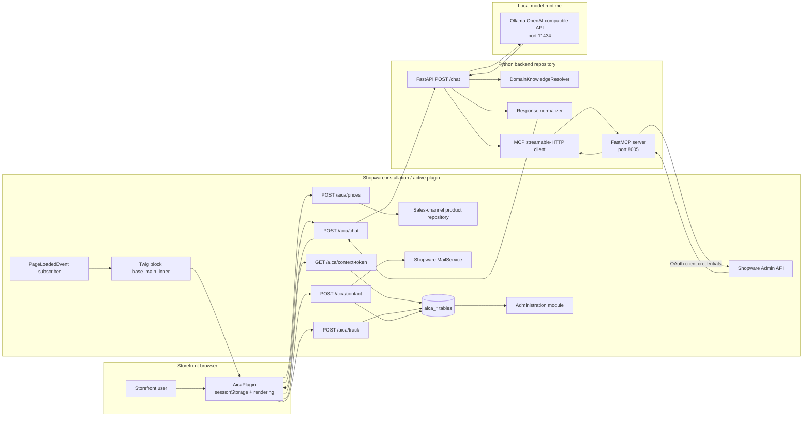
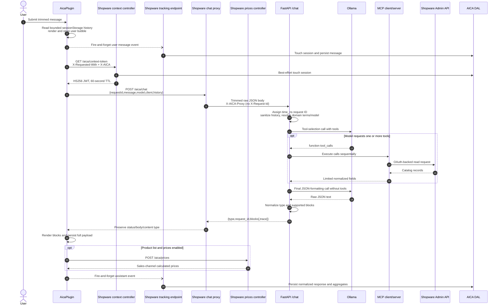
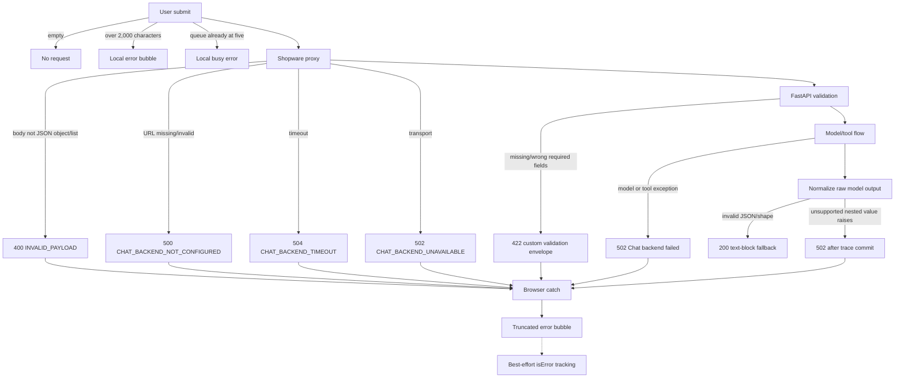
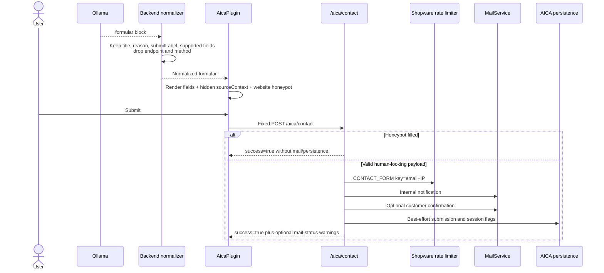

# AICA code walkthrough and architecture

## 1. Purpose and scope

This is the primary, architecture-first walkthrough of the complete AICA application. It describes the implementation as it existed on 2026-07-27 and distinguishes source-verified behavior from runtime observations and future recommendations.

The application is split across two independent Git repositories:

- **[SHOPWARE REPOSITORY]** `/home/paul/shopware-test/custom/plugins/AiCommerceAssistant`
  - Shopware plugin lifecycle and dependency injection
  - Storefront mount point and browser widget
  - Same-origin chat proxy
  - Sales-channel price resolution
  - Contact validation, mail, tracking, persistence, and Administration
- **[BACKEND REPOSITORY]** `/home/paul/shopware-ollama-mcp`
  - FastAPI chat service
  - Domain-knowledge matching
  - Ollama model calls
  - MCP client orchestration
  - MCP server and Shopware Admin API access
  - Structured-response normalization and in-memory tracing

`/home/paul/shopware-test` is the running Shopware installation and Docker Compose project, but it is not itself a Git repository. The active plugin repository is nested beneath it. The legacy checkout at `custom/plugins/PaulAiChat` is installed but inactive and is not part of the current implementation.

Shopware remains authoritative for customer and sales-channel context, catalog visibility at price lookup time, calculated prices, mail delivery, and persisted analytics. The Python backend supplies language-model orchestration and deliberately price-free product discovery. Ollama is a local model runtime, not a source of commerce truth.

The system does not implement checkout, order creation, customer creation, catalog mutation, or ERP synchronization. The MCP tools are read-only. Future directions in this document are observations only; they are not implemented behavior.

### Verification legend

- **Source-verified** means the behavior follows directly from the current code.
- **Runtime-verified** means it was also observed against the running Docker environment.
- **Inferred** means the code suggests intent but the condition was not exercised.
- **Recommendation** means a possible future change, not current behavior.

## 2. Repository maps

### [SHOPWARE REPOSITORY]

```text
AiCommerceAssistant/
├── composer.json
├── src/
│   ├── AiCommerceAssistant.php
│   ├── Subscriber/StorefrontSubscriber.php
│   ├── Storefront/Controller/
│   │   ├── ChatContextController.php
│   │   ├── ChatProxyController.php
│   │   ├── ChatTrackingController.php
│   │   ├── PricesController.php
│   │   └── FormularController.php
│   ├── Service/
│   │   ├── ChatSessionResolver.php
│   │   ├── ChatTrackingService.php
│   │   ├── ChatAnalyticsService.php
│   │   └── ContactSubmissionMailService.php
│   ├── Setup/ContactMailTemplateSetup.php
│   ├── Core/Content/
│   │   ├── ChatSession/
│   │   ├── ChatMessage/
│   │   ├── ContactSubmission/
│   │   └── ProductReference/
│   ├── Migration/Migration1781000000CreateAicaPersistence.php
│   ├── Controller/Api/ChatAnalyticsController.php
│   └── Resources/
│       ├── config/{config,routes,services}.xml
│       ├── views/storefront/page/content/index.html.twig
│       └── app/
│           ├── storefront/src/{main.js,plugin/aica.plugin.js,scss/base.scss}
│           └── administration/src/{app,module,extension}/...
└── tests/Storefront/Controller/
```

| File or area | Layer and responsibility | Called by / depends on | Study relevance |
| --- | --- | --- | --- |
| `composer.json` | Package boundary | Composer and Shopware plugin loader | Confirms `AiCommerceAssistant\` namespace and technical plugin class. |
| `src/AiCommerceAssistant.php` | Plugin lifecycle | Shopware install/update hooks; `ContactMailTemplateSetup` | Creates missing contact mail template types/templates. Uninstall currently performs no data cleanup. |
| `src/Resources/config/config.xml` | Configuration schema | Shopware System Config | Defines all `AiCommerceAssistant.config.*` settings and UI defaults. |
| `src/Resources/config/services.xml` | Dependency injection | Symfony/Shopware container | Registers DAL definitions, controllers, subscriber, repositories, mail, DBAL, rate limiter, and `CHAT_AUTH_SECRET`. |
| `src/Resources/config/routes.xml` | Route discovery | Symfony router | Imports storefront and Administration action controllers. |
| `src/Subscriber/StorefrontSubscriber.php` | Storefront page enrichment | `PageLoadedEvent`, `SystemConfigService` | Adds the `aica` page extension and resolves price-display policy. |
| `src/Resources/views/storefront/page/content/index.html.twig` | Storefront mount point | Extends `@Storefront/storefront/page/content/index.html.twig`, block `base_main_inner` | Emits `data-aica-root` plus route/config data attributes. Pages not based on this content template do not mount the widget. |
| `src/Resources/app/storefront/src/main.js` | Storefront registration | Shopware `PluginManager` | Registers `AicaPlugin` for `[data-aica-root]`. |
| `src/Resources/app/storefront/src/plugin/aica.plugin.js` | Browser application | Twig dataset, Fetch API, `sessionStorage`, marked, DOMPurify | Owns UI construction, history, token fetch, chat queue, block rendering, price enrichment, contact submission, and tracking. |
| `ChatContextController.php` | Storefront security/context endpoint | `SalesChannelContext`, session resolver, tracking service | Creates the short-lived HS256 context JWT and touches an analytics session. |
| `ChatProxyController.php` | Same-origin boundary | System config and Symfony HTTP client | Trims outer whitespace, checks that the body decodes to an array, and passes the raw JSON semantics to backend `/chat`. |
| `PricesController.php` | Commerce authority | `sales_channel.product.repository`, `SalesChannelContext` | Resolves visible/calculated Shopware prices in the current sales-channel context. |
| `FormularController.php` | Contact boundary | validator logic, Shopware rate limiter, mail and tracking services | Validates form data, applies honeypot/rate limiting, sends mail, and persists status. |
| `ChatTrackingController.php` | Analytics ingress | `ChatTrackingService` | Accepts `message` and `contact_form_shown` browser events. |
| `ChatTrackingService.php` | DAL persistence | Four entity repositories, system config, kernel-secret salt | Persists sessions, normalized messages, product references, contact records, privacy flags, and aggregates. |
| `ChatAnalyticsService.php` | Reporting and deletion | Doctrine DBAL | Runs aggregate SQL, CSV exports, and explicit range deletion transactions. |
| `ChatAnalyticsController.php` | Administration action API | ACL metadata and analytics service | Exposes overview/export/delete actions. |
| `Core/Content/*` and migration | Persistence model | Shopware DAL and MariaDB | Define the four `aica_*` tables, API-aware fields, associations, and deletion behavior. |
| `Resources/app/administration` | Administration UI | Generic DAL repositories plus action API | Dashboard, session/contact lists and details, exports, deletion, config link, and ACL mapping. |
| `tests/Storefront/Controller` | Unit coverage | PHPUnit with test doubles | Covers context token, price, and contact controller behavior; many service and cross-repository paths remain untested. |

### [BACKEND REPOSITORY]

```text
shopware-ollama-mcp/
├── app.py
├── shopware_mcp_server.py
├── backend/
│   ├── app/services/
│   │   ├── domain_knowledge_models.py
│   │   ├── domain_knowledge_loader.py
│   │   ├── domain_knowledge_resolver.py
│   │   └── domain_knowledge_prompt.py
│   └── data/domain_terms.json
├── compose.yaml
├── Dockerfile
├── pyproject.toml
├── uv.lock
├── scripts/rebuild_ollama_aliases.sh
└── docs/
```

| File or area | Layer and responsibility | Called by / depends on | Study relevance |
| --- | --- | --- | --- |
| `app.py` | FastAPI chat application | Browser payload via Shopware proxy, OpenAI-compatible Ollama API, MCP client | Contains configuration, prompts, request model, history sanitation, two-phase model orchestration, normalization, endpoints, and tracing. |
| `domain_knowledge_models.py` | Domain data contracts | JSON loader and resolver | Defines sanitized entries and match output. |
| `domain_knowledge_loader.py` | Knowledge source adapter | `backend/data/domain_terms.json` | Loads list-of-object JSON and versions it by file modification time and size. |
| `domain_knowledge_resolver.py` | Deterministic matching | Normalized message and domain entries | Exact, phrase, abbreviation/synonym, singularization, umlaut folding, and optional fuzzy matching. |
| `domain_knowledge_prompt.py` | Prompt adapter | Ranked matches | Converts trusted matches to a compact system-message block. |
| `backend/data/domain_terms.json` | Domain source | Bind-mounted into `/app/backend/data/domain_terms.json` | Current 42-entry vocabulary with synonyms, abbreviations, related terms, search terms, notes, and examples. |
| `shopware_mcp_server.py` | MCP server and Shopware adapter | FastMCP, Shopware Admin API OAuth | Exposes four read-only catalog tools and removes prices and other private fields from results. |
| `compose.yaml` | Local runtime topology | Docker Compose | Runs `server`, `mcp`, and `ollama`; bind-mounts this repository at `/app`. |
| `Dockerfile` | Python image | uv and Python 3.12 | Installs locked dependencies and runs as a non-root application user. |
| `scripts/rebuild_ollama_aliases.sh` | Operations helper | Ollama and environment mappings | Creates model aliases with baked context sizes; it is not part of a request. |
| `main.py` | Generated/stub entry point | Nothing in Compose | Prints a greeting and is not the application server. |

## 3. Runtime architecture



Runtime verification found two separate Compose networks. The Shopware `web` container reaches the host-published backend using `http://host.docker.internal:8002/chat`; the Python server reaches `http://ollama:11434/v1` and `http://mcp:8005/mcp` by service name. The MCP container calls the host-published Shopware Admin API at `http://host.docker.internal:8000`. Uvicorn serves plain HTTP; TLS is not configured inside the backend Compose project.

The live services were:

- Shopware: `web`, database, Mailpit, OpenSearch, and Adminer.
- Backend: `server` (`8002`), `mcp` (`8005`), and `ollama` (`11434`).

Selected deployed values at inspection time:

| Setting | Runtime value |
| --- | --- |
| Active plugin | `AiCommerceAssistant`; legacy `PaulAiChat` installed but inactive |
| Shopware backend target | `http://host.docker.internal:8002/chat` |
| Storefront-requested model | `granite4.1:8b` |
| Backend fallback model | `llama3.1:8b` |
| Effective Ollama context | 16,384 |
| Product price visibility / mode | `none` / `advanced-first` |
| Price hint | enabled |
| Storefront debug / raw payload / raw IP | disabled / disabled / disabled |
| Customer confirmation mail | enabled |
| Backend trace / dry-run | enabled / disabled |
| Ollama parallelism / maximum loaded models | 1 / 1 |

Before the single chat test, `ollama ps` showed no loaded model and the RTX
3080 (12,288 MiB) had about 10,162 MiB free. After the configured Granite
request, Ollama reported the model fully on GPU with a 16,384-token context,
and about 2,149 MiB remained free. The inspection did not force or configure a
different model.

### Cross-repository call references

| Call | Source | Destination | Effective contract |
| --- | --- | --- | --- |
| Chat request | **[SHOPWARE REPOSITORY]** `src/Resources/app/storefront/src/plugin/aica.plugin.js`, through `src/Storefront/Controller/ChatProxyController.php` | **[BACKEND REPOSITORY]** `app.py`, `POST /chat` | Raw JSON `{requestId,message,model,client,history}`; Python ignores unknown `requestId`. |
| Chat response | **[BACKEND REPOSITORY]** `app.py`, `normalize_chat_reply()` | **[SHOPWARE REPOSITORY]** `ChatProxyController.php`, then `aica.plugin.js` | `{type,request_id,blocks[,trace]}` with four supported block kinds. |
| Product/card data | **[BACKEND REPOSITORY]** `app.py` → `shopware_mcp_server.py` | **[SHOPWARE REPOSITORY / running Shopware platform]** Admin API product/category endpoints | OAuth-backed read; limited fields, no price, but no storefront visibility context. |
| Form block to submission | **[BACKEND REPOSITORY]** `app.py`, form normalization | **[SHOPWARE REPOSITORY]** `aica.plugin.js` → `src/Storefront/Controller/FormularController.php` | Backend endpoint/method are removed; JavaScript always uses `POST /aica/contact`. |
| Product price enrichment | Backend product IDs arrive through `app.py` | **[SHOPWARE REPOSITORY]** `aica.plugin.js` → `src/Storefront/Controller/PricesController.php` | Shopware re-resolves authoritative sales-channel prices; backend does not calculate them. |

## 4. End-to-end successful chat sequence



Important ordering details:

1. The browser reads history before storing the new user message, so the current message is present once, as `message`.
2. Chat jobs are serialized in a Promise queue; at most five are pending/queued.
3. Token acquisition is best-effort. A token failure does not stop the chat request; an empty token is sent.
4. The body’s numeric `requestId` is not the backend request ID. `ChatIn` ignores it, and the proxy does not create or forward `X-Request-Id`.
5. A normal non-dry-run success always makes two Ollama calls. The first chooses tools; the second formats the final response. With no tool request, MCP is skipped but the second model call still occurs.
6. If the first phase requests multiple tools, they run sequentially. The implementation performs one tool-selection round, despite the loop’s nominal eight-iteration bound.
7. Browser tracking is asynchronous and non-blocking, so persistence can interleave with chat and rendering.

The one controlled live request used the configured storefront model `granite4.1:8b`, made two model calls and no tool call, and returned a normalized text block. The first and final phases took approximately 4.7 s and 1.6 s respectively. This was a direct backend test with an explicit `X-Request-Id`; it did not create Shopware tracking/contact data.

## 5. Error flow



- FastAPI validation occurs before the endpoint body, so validation failures have no request trace.
- Validation, model, and tool exceptions occur before trace commit, so those failures have no stored trace.
- Invalid JSON and many unsupported output shapes receive a recoverable text fallback, usually with HTTP 200. Certain type-invalid nested values can instead make normalization raise after the trace has already been stored, producing HTTP 502 with a retrievable trace.
- Unknown or expired traces return 404 `{"message":"Trace not found"}`. This is not a filesystem-path error.
- Browser tracking failures are logged only when storefront debug mode is enabled and never replace the visible chat result.
- The proxy can relay an upstream error body, and the widget may show a truncated version of that body to the shopper.

## 6. Product discovery and price flow

Product discovery and price calculation intentionally use different boundaries:

```text
[BACKEND REPOSITORY]
app.py -> shopware_mcp_server.py
    discovers limited product/category records through the Shopware Admin API

[SHOPWARE REPOSITORY]
src/Resources/app/storefront/src/plugin/aica.plugin.js
    renders suggestions and requests prices from:

[SHOPWARE REPOSITORY]
src/Storefront/Controller/PricesController.php
    resolves authoritative prices with sales_channel.product.repository
```

### Discovery

The MCP server exposes:

- `search_products_public(query, limit=10, locale=de-DE)`, with limit clamped to 1–100
- `get_product_by_id_public(id, locale=de-DE)`
- `get_product_by_number_public(product_number, limit=1, locale=de-DE)`, with limit clamped to 1–10
- `list_categories(parent_id=None, limit=50, locale=de-DE)`, with limit clamped to 1–100

Product results contain `id`, `name`, `productNumber`, `purchaseUnit`, `unitShortCode`, and `unitName`. Categories contain `id`, `name`, `parentId`, `level`, and `active`. Prices, conditions, stock, delivery data, media, descriptions, and customer data are deliberately excluded by normalization.

The current Admin API criteria do not filter product `active`, storefront visibility, sales channel, or category assignment. The `locale` argument is accepted but is not applied to a Shopware language header or criteria. Consequently, “public” describes the returned field set, not a proven storefront-visibility guarantee.

The format prompt asks the model to represent categories with `product_list` because no category block exists. The storefront treats every such entry as a product and links to `/detail/{id}`; category IDs therefore produce product-detail links.

### Rendering and price authority

The widget requires both a non-empty `id` and `name` to render a product card. It builds the link as `${window.location.origin}/detail/{id}` and does not use the computed sales-channel `basePath` or a backend `detailUrl`.

If price display is allowed, the browser posts at most 50 unique product IDs to `/aica/prices`. The controller:

- validates UUIDs;
- searches with `sales_channel.product.repository`;
- therefore applies Shopware sales-channel visibility, rules, currency, tax, and customer context;
- returns calculated unit/total/list/regulation prices and calculated tier prices.

The frontend uses `calculatedPrice.unitPrice` in `calculated` mode. In `advanced-first` mode it prefers a calculated tier with quantity 1, then the first numeric tier, then the calculated unit price.

The source-of-truth boundary is important: the model can suggest identifiers, but Shopware decides whether a product is returned by the price repository and which current price applies. When price display is allowed, a backend-supplied `price` can technically survive normalization and be rendered; it remains visible if enrichment fails or returns no matching authoritative price, although the public prompt and MCP field set prohibit prices.

Price policy values are `all`, `customers`, or `none`. The page subscriber treats a Shopware guest customer as not logged in, but `PricesController` currently checks only whether a customer object exists. Direct calls from guest-customer contexts can therefore differ from the UI’s “customers only” decision.

## 7. Contact flow



The backend prompt currently contains the stale legacy endpoint `/paul-ai-chat/contact`. This does not control runtime submission because `normalize_blocks()` removes `endpoint` and `method`, while the browser always posts to `/aica/contact`. The mismatch is still a documentation and future-maintenance risk.

Recognized fields and maximum lengths are:

| Field | Required | Maximum |
| --- | --- | ---: |
| `name` | No; defaults to `Shop-Kunde` | 120 |
| `email` | Yes; validated | 254 |
| `phone` | No | 40 |
| `company` | No | 120 |
| `productRef` | No | 120 |
| `quantity` | No | 40 |
| `deliveryZip` | No | 20 |
| `sourceContext` / `reason` | No | 255 |
| `message` | Yes | 5,000 |

The hidden `website` field is a honeypot. A filled honeypot receives a successful response without side effects to avoid giving bots validation feedback. Other accepted requests are rate-limited using Shopware’s `CONTACT_FORM` limiter keyed by lowercased email plus client IP. Because the caller controls the email portion, rotating addresses creates new buckets and can bypass the intended per-source throttle.

The internal recipient falls back from `AiCommerceAssistant.config.contactRecipientEmail` to `core.basicInformation.email`, then `core.mailerSettings.senderAddress`. Confirmation mail is separately configurable. Plugin install/update creates missing German and English template types/templates, but preserves any existing templates rather than updating their source text.

A valid submission can return `success: true` even when mail sending or persistence fails. The response may include `internalMailStatus: "not-sent"` or `confirmationMailStatus: "not-sent"`, but the current browser shows a generic success for every HTTP-success response.

## 8. Main data contracts

Examples are shortened and contain no live tokens, credentials, or personal information.

### Storefront chat request

```json
{
  "requestId": 1,
  "message": "Welche Backmittel gibt es?",
  "model": "granite4.1:8b",
  "client": {
    "origin": "https://shop.example",
    "basePath": "",
    "fullBaseUrl": "https://shop.example",
    "contextToken": "<short-lived-jwt>"
  },
  "history": [
    {"role": "assistant", "content": "Wie kann ich helfen?"}
  ]
}
```

The Shopware proxy trims outer whitespace and otherwise forwards this raw JSON body without re-encoding it. The backend requires `message` and `model` to be strings, defaults `history` and `client` to empty containers, and ignores unknown root fields such as `requestId`.

### Context-token response and claims

```json
{"token": "<header.payload.signature>"}
```

```json
{
  "sid": "<storefront-session-identifier>",
  "salesChannelId": "<shopware-uuid>",
  "iat": 1785150000,
  "exp": 1785150060,
  "jti": "<random-hex-string>"
}
```

The token is HS256-signed with `CHAT_AUTH_SECRET` and valid for 60 seconds. It is
pseudonymous rather than anonymous: it contains no customer ID or logged-in flag,
but its stable `sid` can link to a persisted Shopware session/customer. `jti` is
normally 16 hexadecimal characters; the exception fallback produces 64. The backend
accepts the token inside `client` but does not decode, validate, or use it.

### Backend request model

```text
ChatIn
├── message: str                 required
├── model: str                   required; empty string selects backend default
├── history: list[dict]          default []
└── client: dict                 default {}
```

Extra root fields are ignored. History sanitation keeps only dictionary entries whose role is `user` or `assistant` and whose content is a string. The backend imposes no independent entry-count or character limit.

### Tool call and MCP result

```json
{
  "type": "function",
  "function": {
    "name": "search_products_public",
    "arguments": "{\"query\":\"Backmittel\",\"limit\":5,\"locale\":\"de-DE\"}"
  }
}
```

```json
{
  "items": [
    {
      "id": "<product-uuid>",
      "name": "Backmittel Beispiel",
      "productNumber": "A-100",
      "purchaseUnit": 10,
      "unitShortCode": "kg",
      "unitName": "Kilogramm"
    }
  ],
  "count": 1
}
```

Tool arguments are JSON-decoded in `app.py`, then dispatched through MCP. Type/required-argument enforcement is delegated to the MCP tool layer; there is no separate backend allowlist validator around returned model calls.

### Normalized response envelope

```json
{
  "type": "answer",
  "request_id": "1785150000123456789",
  "blocks": [
    {"kind": "text", "text": "Ich habe einen passenden Artikel gefunden."}
  ],
  "trace": []
}
```

`type` is `answer`, `clarification`, or `error`, defaulting to `answer`. `trace` is present in chat responses only when runtime tracing is enabled. The deployed environment had tracing enabled.

### Text and info-box blocks

```json
{"kind": "text", "text": "Markdown **is allowed**."}
```

```json
{
  "kind": "info_box",
  "style": "warning",
  "title": "Hinweis",
  "text": "Bitte klären Sie Konditionen individuell."
}
```

The frontend parses Markdown through `marked` and sanitizes the HTML through DOMPurify. Info styles are restricted to `info`, `warning`, and `error`.

### Product-list block

```json
{
  "kind": "product_list",
  "title": "Treffer",
  "products": [
    {
      "id": "<product-uuid>",
      "name": "Produkt",
      "productNumber": "A-100",
      "purchaseUnit": "10",
      "unitShortCode": "kg"
    }
  ]
}
```

The backend normalizer also accepts `price` and stringifies accepted values. The browser skips records without both `id` and `name`.

### Form block

```json
{
  "kind": "formular",
  "title": "Kontakt",
  "reason": "Individuelle Konditionen",
  "submitLabel": "Anfrage senden",
  "fields": [
    {
      "key": "email",
      "label": "E-Mail",
      "type": "email",
      "placeholder": null,
      "required": true,
      "value": null
    },
    {
      "key": "message",
      "label": "Nachricht",
      "type": "textarea",
      "placeholder": null,
      "required": true,
      "value": null
    }
  ]
}
```

Supported field types are `text`, `email`, `textarea`, `tel`, and `number`; invalid types become `text`.

### Tracking events

```json
{
  "event": "message",
  "role": "assistant",
  "messageIndex": 2,
  "requestId": 1,
  "messageType": "structured",
  "model": "granite4.1:8b",
  "text": "Compact rendered text",
  "payload": {"type": "answer", "blocks": []},
  "tokenUsage": null,
  "latencyMs": 6400,
  "flags": {
    "containsProductSuggestions": false,
    "containsInfoBox": false,
    "containsFormular": false,
    "containsToolPayload": false,
    "isError": false
  },
  "productReferences": []
}
```

```json
{"event": "contact_form_shown"}
```

The normal widget sends the browser request ID as a number. `ChatTrackingService`
accepts only a string for the persisted `requestId`, so this numeric value is
dropped. A crafted string-valued tracking event could populate the field, but it
would still not be the backend `request_id`.

### Price request and response

```json
{"productIds": ["<product-uuid>"]}
```

```json
{
  "prices": {
    "<product-uuid>": {
      "name": "Produkt",
      "calculatedPrice": {
        "unitPrice": 12.5,
        "totalPrice": 12.5,
        "listPrice": null,
        "regulationPrice": null
      },
      "calculatedPrices": [
        {"unitPrice": 11.5, "totalPrice": 11.5, "quantity": 1, "listPrice": null}
      ],
      "hasAdvancedPrices": true,
      "currency": "EUR"
    }
  }
}
```

### Contact submission

```json
{
  "name": "Example Person",
  "email": "person@example.invalid",
  "phone": "",
  "company": "Example",
  "message": "Bitte kontaktieren Sie mich.",
  "productRef": "A-100",
  "quantity": "10",
  "deliveryZip": "00000",
  "sourceContext": "Individuelle Konditionen",
  "website": ""
}
```

### Important DAL entities

| Entity / table | Important fields | Relationship behavior |
| --- | --- | --- |
| `aica_chat_session` | sales channel/language/customer IDs, stable session identifier, guest hashes, optional raw IP/UA, model, usage/latency aggregates, contact/debug flags | Unique session identifier; customer/sales channel/language become null if their source records are deleted. |
| `aica_chat_message` | role/index, raw text, selected rendered JSON, block kinds, usage, latency, model, request ID, flags, optional debug payload | Required session; cascade-deleted with session; unique session/index pair. |
| `aica_contact_submission` | contact PII, message, product/source context, mail target and status/errors | Session/customer links are nullable and set null when the linked record is deleted. Quantity and ZIP are mailed but not persisted. |
| `aica_product_reference` | source, product ID/number/name/reference text | String references, not product foreign keys; message delete cascades, session delete sets null unless explicitly cleaned by analytics deletion. |

All fields are API-aware. Administration ACL therefore matters for access to personal and debug data.

## 9. Shopware integration points

### Lifecycle and mail setup

`AiCommerceAssistant::install()` and `::update()` call `ContactMailTemplateSetup::install()`. The setup is idempotent in the sense that it creates missing records and does not overwrite existing templates. Activate, deactivate, post-install, and post-update hooks are empty. Uninstall does not remove plugin data or mail templates, regardless of `keepUserData`.

### Dependency injection and route scope

`services.xml` explicitly wires controllers, repositories, DBAL, `SystemConfigService`, `MailService`, `RateLimiter`, the Symfony HTTP client, logger, request stack, `%kernel.secret%`, and `%env(string:CHAT_AUTH_SECRET)%`. `routes.xml` imports attribute routes.

Storefront routes declare `_routeScope: ['storefront']` and `XmlHttpRequest: true`. Context, price, tracking, and contact controllers also check both `X-Requested-With: XMLHttpRequest` and `X-AICA: 1`. These are request-intent markers, not authentication. The chat proxy does not perform the explicit two-header check.

Administration routes declare API scope and `_acl` requirements.

### `SalesChannelContext` versus `Context`

- `SalesChannelContext` carries the active sales channel, currency, tax/rule state, customer, and sales-channel product visibility. It is essential to `/aica/prices`, contact mail, and storefront identity.
- The underlying DAL `Context` is used for entity repository reads/writes and mail templates.
- The backend’s MCP access uses the Shopware Admin API and does not possess `SalesChannelContext`.

### Page extension and Twig inheritance

`StorefrontSubscriber` listens to every `PageLoadedEvent` and adds an `ArrayEntity` named `aica`. The Twig template extends the Storefront content-page template and appends a root element in `base_main_inner`. It reads the page extension for price policy and uses `config()` for route-independent widget values.

### Storefront plugin registration

`main.js` registers `AicaPlugin` on `[data-aica-root]`. Shopware instantiates it when the compiled storefront discovers that selector. The plugin creates the floating button and dialog entirely in JavaScript beneath the Twig root.

### DAL, SQL, and Administration

Four entity definitions register through `shopware.entity.definition`. Lists and details use generic Administration DAL repositories. Dashboard overview, CSV, and deletion use six custom action routes backed by DBAL SQL.

ACL mappings are:

- `aica.viewer`: AICA entity reads plus customer, sales-channel, and language reads.
- `aica.manager`: AICA reads/deletes and related reads; depends on viewer.
- `aica_debug.viewer`: session/message reads; depends on viewer.

The last mapping is a UI distinction only: the same raw/debug fields are API-aware, and `aica.viewer` already grants entity reads.

## 10. Backend integration points

### Startup and configuration

Importing `app.py` loads `.env`, parses configuration, builds model/context mappings, creates a synchronous OpenAI client for Ollama, creates the lazy MCP session cache, eagerly initializes the domain resolver, and then constructs FastAPI. Lifespan shutdown closes the MCP session.

The runtime endpoints are:

- `GET /healthz`
- `POST /chat`
- `GET /trace/{request_id}`

The backend repository has no contact, price, tracking, persistence, or authentication endpoint.

Important environment variables:

| Variable | Current role |
| --- | --- |
| `CHAT_HOST`, `CHAT_PORT` | Parsed by Python; Docker’s command currently hard-codes `0.0.0.0:8002`. |
| `CHAT_LOGGING_LEVEL` | Backend logger level. User messages are logged at INFO. |
| `CHAT_DRY_RUN` | Returns local blocks without Ollama; produces no trace. |
| `CORS_ORIGINS`, `CORS_ORIGIN_REGEX` | Browser CORS policy; deployed runtime used four explicit HTTP origins. |
| `OLLAMA_BASE_URL`, `OLLAMA_API_KEY`, `OLLAMA_MODEL` | Ollama OpenAI-compatible target, placeholder API key, and fallback model. |
| `OLLAMA_NUM_CTX` | Default context size. Runtime value: 16,384. |
| `OLLAMA_NUM_CTX_BY_MODEL` | Optional `model=size` overrides. Runtime mapping was empty. |
| `OLLAMA_MODEL_ALIAS_BY_MODEL` | Optional requested-model to runtime-alias mapping. Runtime mapping was empty. |
| `MCP_URL` | Streamable-HTTP MCP endpoint. Runtime: `http://mcp:8005/mcp`. |
| `DOMAIN_KNOWLEDGE_ENABLED` | Enables resolver construction. |
| `DOMAIN_KNOWLEDGE_PATH` | Host-relative or absolute/container path. Runtime: `/app/backend/data/domain_terms.json`. |
| `DOMAIN_KNOWLEDGE_MAX_MATCHES` | Maximum injected matches. Runtime: 4. |
| `DOMAIN_KNOWLEDGE_ENABLE_FUZZY` | Enables fuzzy stage. Runtime: true. |
| `DOMAIN_KNOWLEDGE_FUZZY_THRESHOLD` | Minimum fuzzy ratio. Runtime: 0.93. |
| `TRACE_ENABLED` | Enables response and endpoint traces. Runtime: true. |
| `DEFAULT_LOCALE` | Default MCP tool parameter. It is not currently applied to Shopware requests. |
| `SHOPWARE_BASE_URL`, `SHOPWARE_CLIENT_ID`, `SHOPWARE_CLIENT_SECRET` | MCP server’s Admin API OAuth client credentials. |

`CHAT_AUTH_SECRET` existed on both sides at runtime, but the tracked Python code never reads it.

### Model selection and context

The non-empty request `model` wins over `OLLAMA_MODEL`. This means the browser-selected value controls model loading unless an alias mapping replaces it. Empty model strings fall back to the environment default. Common `registry.ollama.ai/library/` prefixes are normalized for mapping lookups.

The deployed Storefront configured `granite4.1:8b`; backend health reported fallback `llama3.1:8b`. The live request correctly used Granite. The backend currently has no model allowlist.

### Domain knowledge

The resolver loads 42 JSON entries and automatically checks the source version on each message. Candidate sources are canonical names, synonyms, abbreviations, and related terms.

Matching stages rank exact matches above phrase matches above fuzzy matches. Normalization includes lowercase, punctuation/space normalization, optional German umlaut folding, and conservative singularization. Fuzzy candidates are restricted to canonical names and synonyms of a minimum length, then require the configured threshold. At most four matches are injected into a trusted system block in the deployed configuration.

The block guides tool query terms; it does not itself return catalog data.

### Prompts and two model calls

The tool-selection system prompt defines public tools and prohibits price/stock/delivery/legal inventions. The first Ollama call uses tools with automatic selection and temperature 0.2.

Any returned function calls are JSON-decoded and executed through the cached MCP session. Tool results are appended as tool-role messages. The code does not append the first assistant message/tool-call record itself.

The second Ollama call replaces the first system message with the public formatting prompt, disables tools, asks for a JSON object, and uses temperature 0.2. Its content is normalized before returning to Shopware.

Both Ollama calls use the synchronous OpenAI client inside an async endpoint. This blocks the event loop while each call is in progress.

### MCP and Shopware OAuth

The backend is an MCP client; `shopware_mcp_server.py` is the MCP server. The client caches one streamable-HTTP session and reconnects once after a call error.

The MCP server obtains a Shopware Admin API token using client credentials at `/api/oauth/token`, caches it until 30 seconds before expiry, then reads `/api/search/product`, `/api/product/{id}`, or `/api/search/category`. OAuth calls use a 10-second HTTP timeout; Shopware resource calls use 15 seconds.

### Response normalization

The backend accepts only `text`, `info_box`, `product_list`, and `formular`. Unknown block kinds and many malformed entries are dropped. If supported blocks remain, it returns them with backend `request_id`. Otherwise it falls back to `reply`, `message`, or the raw model text in a text block. Independently, the frontend renderer displays an otherwise unknown block as a bot bubble when it has truthy `text`; without text it ignores the block.

Normalization is permissive rather than schema-validating. Some deeply wrong JSON types are not safely reduced: for example, an unhashable response `type`/info-box `style`, or non-iterable `products`/`fields`, can raise and become a 502 response. Because trace commit occurs immediately before normalization, that failure can still leave a retrievable trace.

Kinds and keys are allow-listed, but block/product/field counts and retained
string lengths are not bounded. A large valid model shape can therefore expand
the storefront DOM, `sessionStorage` record, and tracking payload. The normalizer
is the effective backend-to-Shopware contract; prompt examples alone are not
authoritative.

### Container paths

Both Python services bind-mount the repository root to `/app`. Therefore:

```text
[CONTAINER] /app/backend/data/domain_terms.json
maps to
[BACKEND REPOSITORY] /home/paul/shopware-ollama-mcp/backend/data/domain_terms.json
```

Runtime size and SHA comparison confirmed that they were the same file. `/app/...` must not be interpreted as a WSL host path.

## 11. Security and privacy boundaries

| Boundary | Current protections | Partial protections or open risks | Future direction |
| --- | --- | --- | --- |
| Browser → Shopware | Same-origin routes, storefront scope, AJAX markers on most endpoints, input limits for chat/contact, contact honeypot and rate limiter, DOMPurify for Markdown | AJAX headers are forgeable; proxy has no explicit marker check, rate limit, or size limit. Tracking has no consent/config toggle and accepts client-asserted roles, text, indexes, metrics, flags, payloads, and references without event-size or integrity bounds, allowing analytics pollution/storage growth. | Add server-derived analytics fields, validation, size/rate/idempotency controls, and a documented consent/retention policy. |
| Shopware → backend | Backend URL comes from privileged system config; proxy sends `X-AICA-Proxy`; 60-second proxy timeout | Backend does not authenticate the header or JWT; port 8002 is host-published; proxy can target HTTP/internal hosts and relays upstream bodies. MCP port 8005 and Ollama port 11434 are also host-published without application authentication. | Authenticate requests, restrict model/backend targets, avoid unnecessary port publication, and consider network isolation/TLS appropriate to deployment. |
| Context token | Shopware-signed HS256 token, 60-second TTL, no-cache response, random `jti` | Backend ignores the token and does not read the configured secret; no customer claim; browser debug logs it. It currently grants nothing. | Validate and bind claims before using the token for authorization, or remove the unused ceremony. |
| Backend → model | Public prompt prohibits sensitive commerce inventions; tool fields are limited | User and history content go to the local model; arbitrary request model names are honored; backend has no request size cap. | Add allowlists/bounds and document local model data handling. |
| Backend → MCP/Shopware API | OAuth client credentials remain in environment; token cached in memory; read-only tool functions; result field minimization | Admin API search does not enforce storefront active/visibility/sales-channel context. | Query a sales-channel-aware service or explicitly filter/verify public visibility. |
| Product prices | Resolved by Shopware sales-channel repository; visibility config; no price fields in MCP result | Guest-customer enforcement differs between UI and controller; when display is allowed, a backend `price` remains visible if authoritative enrichment fails or has no match. | Centralize price authorization and reject non-authoritative model prices. |
| Browser storage | `sessionStorage` is tab-scoped and bounded to 60 records | Full structured response—including live trace—is stored; clearing it does not delete server data. | Exclude internal trace/debug data and explain client/server deletion separately. |
| Shopware persistence | Guest IP/UA hashes use salted SHA-256; raw IP requires debug plus opt-in; full debug payload requires two flags | Normal chat text/blocks and stable session IDs are stored independently of debug when best-effort persistence succeeds; raw UA needs debug only; customer-linked upserts do not clear guest/raw identifiers captured earlier; no automatic retention; all fields API-aware. | Add retention/anonymization and transition clearing, minimize fields, and make debug ACL technically enforceable. |
| Contact data | Validation, length caps, email validation, honeypot, rate limit, ACL-protected Administration | Free text can contain personal data; rotating caller-controlled email values changes the email+IP limiter bucket; mail and persistence are attempted for valid non-honeypot data, but success can hide either failure. | Layer IP/session/global throttles, document legal basis/retention, and surface delivery status appropriately. |
| Administration/export | Route ACLs, viewer/manager roles, explicit typed deletion confirmation | CSV can contain customer/contact PII and full messages; user-controlled cells are passed to `fputcsv` without neutralizing spreadsheet formula prefixes; `aica_debug.viewer` does not isolate API fields. | Split sensitive fields/endpoints behind enforceable privileges, neutralize spreadsheet formulas, and audit exports/deletions. |
| Secrets/config | Docker env files and non-root Python user | A tracked `.env.local` declares credential-bearing keys and is not excluded from Docker's `COPY . /app`; backend host ports are open; CORS is not authentication. | Remove/rotate tracked secrets, exclude them from image context, and use a secret store; restrict published interfaces. |

For guest storefront sessions, Shopware stores salted hashes of IP, user agent, and a composite fingerprint. A currently customer-linked session skips new guest hashing, but its upsert omits rather than clears guest hashes or raw identifiers captured while the same storefront session was anonymous. Raw IP storage requires debug mode and `storeRawIpAddress`; raw user agent requires debug mode alone at capture time. Normalized message text, selected structured blocks, product references, and contact records are not debug-only.

The deployed backend had `TRACE_ENABLED=1`. Successful chat responses therefore included trace events, the proxy sent them to the browser, and the widget persisted the whole structured response in `sessionStorage`. Trace events can contain model messages, domain matches, user-derived tool arguments, tool results, latency, and usage. OAuth tokens are not intentionally added to traces, but user and business data can be present.

## 12. Error handling and observability

### Frontend

- Rejects empty and over-2,000-character messages locally.
- Serializes requests and limits pending/queued requests to five.
- Displays backend/proxy failures as a truncated error bubble.
- Tracks the error asynchronously with `isError`.
- Uses debug-gated console logging, but debug output includes request history, context JWT, and complete backend responses.

### Shopware proxy and local endpoints

- Proxy maps timeout to 504, transport errors to 502, and unexpected errors to 500.
- Upstream statuses/bodies/content type are otherwise preserved.
- Context, tracking, price, and contact errors use route-specific JSON codes.
- Tracking and contact persistence are best-effort in several paths.
- Contact returns success after validation even if mail sending failed.

### Backend

- Custom `HTTPException` responses are `{"message":"..."}`.
- Custom validation responses are `{"message":"Invalid request body","details":[...]}` with 422.
- Framework-generated method errors such as GET on `/chat` can still use Starlette’s `{"detail":...}` envelope.
- OpenAPI documents the request fields but has empty response schemas and advertises a standard 422 shape that differs from the custom runtime body.
- The health endpoint reports configuration, not downstream readiness; it does not probe Ollama, MCP, GPU, or Shopware.

### Request IDs and traces

Backend request IDs come from `X-Request-Id` or `time.time_ns()`. The storefront sends a numeric `requestId` in JSON, but the proxy neither creates nor forwards the header. Backend `request_id` is not mapped back into tracking, and Shopware's string normalizer drops the widget's numeric value. Normal storefront traffic therefore persists no request ID for the message while the backend uses a separate trace ID.

Traces:

- are process-local dictionaries, not files;
- exist only when `TRACE_ENABLED=1`;
- are committed after both model phases and any tools complete, immediately before response normalization;
- include ordinary normalization fallbacks but not validation/model/tool failures or dry-run responses;
- become eligible for eviction after 600 seconds;
- are cleaned lazily on the next `/chat` or `/trace` request, so stale entries can remain resident for longer than 600 seconds while idle;
- disappear on process restart and are not shared between workers;
- return 404 when disabled, unknown, or expired;
- are unauthenticated in the current deployment.

The controlled live trace contained four events: tool-phase request/response and final-phase request/response. Usage totaled 4,568 tokens across both calls, but usage and phase latency were present only inside trace events. The frontend’s tracking extractors do not inspect trace, so Shopware token fields remained unavailable; latency fell back to browser wall time and model name to the configured request value.

### Administration analytics

The dashboard reports sessions, contacts, product references, tokens, and assistant/tool latency when those fields exist. There is no automatic cleanup. Manual deletion is range-based:

- Session deletion uses session `created_at`, deletes related messages and product references, and leaves contact submissions with a null session link.
- Contact deletion deletes contact rows but can leave contact-sourced product-reference rows.
- Browser “clear history” affects only `sessionStorage`.
- Plugin uninstall performs no persistence cleanup.

## 13. Recommended source reading order

1. **Package and wiring**
   - [SHOPWARE] `composer.json`, `src/Resources/config/config.xml`, `services.xml`, `routes.xml`
   - Learn the technical name, config domain, service graph, and route discovery.
   - Next: see how configuration reaches a page.

2. **Page mount**
   - [SHOPWARE] `src/Subscriber/StorefrontSubscriber.php`
   - [SHOPWARE] `src/Resources/views/storefront/page/content/index.html.twig`
   - Understand `PageLoadedEvent`, `SalesChannelContext`, the `aica` page extension, block inheritance, and data attributes.
   - Next: follow the selector into JavaScript.

3. **Browser entry and state**
   - [SHOPWARE] `src/Resources/app/storefront/src/main.js`
   - [SHOPWARE] `src/Resources/app/storefront/src/plugin/aica.plugin.js` through `onSubmit()`
   - Study UI creation, `sessionStorage`, bounds, and queuing.
   - Next: trace token and proxy requests.

4. **Context and proxy**
   - [SHOPWARE] `ChatSessionResolver.php`, `ChatContextController.php`, `ChatProxyController.php`
   - Understand Shopware sessions, JWT claims, request markers, backend URL normalization, and raw-body forwarding.
   - Next: cross the repository boundary.

5. **Backend ingress**
   - [BACKEND] `app.py`: environment parsing, `ChatIn`, exception handlers, `/healthz`, `/chat`
   - Distinguish browser payload, Pydantic model, sanitized history, model selection, and backend request ID.
   - Next: inspect deterministic domain context.

6. **Domain knowledge**
   - [BACKEND] `domain_knowledge_models.py`, loader, resolver, prompt builder, then `domain_terms.json`
   - Learn source versioning, exact/phrase/fuzzy ranks, and injected match structures.
   - Next: inspect model/tool prompts without changing them.

7. **Model and MCP orchestration**
   - [BACKEND] `app.py`: `TOOLS_PUBLIC`, `chat_with_tools()`, `call_mcp_tool()`
   - [BACKEND] `shopware_mcp_server.py`
   - Follow the two model phases, tool call/result shape, OAuth cache, Admin API criteria, and field minimization.
   - Next: see how raw model output becomes a browser contract.

8. **Normalization and rendering**
   - [BACKEND] `normalize_blocks()`, `normalize_chat_reply()`
   - [SHOPWARE] `aica.plugin.js`: `handleBotResponse()`, block renderers
   - Compare accepted fields with actual DOM behavior and fallback paths.
   - Next: separate product discovery from price calculation.

9. **Prices**
   - [SHOPWARE] `PricesController.php`
   - [SHOPWARE] `aica.plugin.js`: `renderProductList()`, `fetchCalculatedPrices()`
   - Understand sales-channel authority, visibility policy, and tier selection.
   - Next: inspect side effects.

10. **Tracking and persistence**
    - [SHOPWARE] `ChatTrackingController.php`, `ChatTrackingService.php`
    - [SHOPWARE] DAL definitions and migration
    - Study privacy gates, always-stored data, aggregates, product references, and FK behavior.
    - Next: follow contact side effects.

11. **Contact and mail**
    - [SHOPWARE] `FormularController.php`, `ContactSubmissionMailService.php`, `ContactMailTemplateSetup.php`
    - Understand validation, honeypot, rate limiting, mail fallbacks, persistence, and status semantics.
    - Next: see who can inspect/delete data.

12. **Administration and operations**
    - [SHOPWARE] Administration module, ACL, `ChatAnalyticsController.php`, `ChatAnalyticsService.php`
    - [BACKEND] `compose.yaml`, `Dockerfile`, backend walkthrough
    - Connect persistence to reporting, deletion, container paths, health, and trace limitations.

## 14. Rework catalogue

These are future directions only.

| Area | Repository | Current behavior | Finding type | Reason to revisit | Risk | Future direction |
| --- | --- | --- | --- | --- | --- | --- |
| Context authentication | Both | Signed JWT is sent but ignored; proxy header unauthenticated | Verified issue · security/API design | Security mechanism has no enforcing consumer | High | Authenticate proxy requests and validate token claims, or remove unused token flow. |
| Backend exposure | Backend | `/chat` and `/trace` are host-published and unauthenticated | Likely risk · security/operations | Expensive inference and trace data can be reached outside Shopware if host networking allows | High | Network-isolate, authenticate, rate-limit, and restrict trace access. |
| Model selection | Backend | Any non-empty request model wins | Verified issue · model runtime/reliability | Client can trigger unapproved model loads or failures | High | Allowlist configured models server-side. |
| Request bounds | Both | Browser has bounds; proxy/backend do not | Verified issue · reliability/security | Direct callers can bypass client limits | High | Enforce body, message, history, and concurrency limits server-side. |
| Response bounds | Both | Normalized block/product/field counts and strings are unbounded | Likely risk · reliability/frontend | Large model output can expand DOM, browser storage, and tracking payloads | Medium | Bound the normalized response envelope and truncate/reject oversized output. |
| Product visibility | Backend | Admin API discovery has no active/visibility/sales-channel filter | Verified issue · Shopware integration/security | Suggestions may expose or link non-storefront products | High | Use a sales-channel-aware API or explicit visibility verification. |
| Trace privacy | Backend/Shopware browser | Trace is embedded in response and sessionStorage; trace endpoint unauthenticated | Verified issue · privacy/observability | Internal messages/tool results and user data leave the backend | High | Separate internal tracing from public response and protect/redact it. |
| Correlation IDs | Both | Browser numeric ID is dropped by tracking; backend creates a separate trace ID | Verified issue · observability | Operations cannot correlate normal storefront messages to backend requests | Medium | Create/forward one bounded ID and return/store it consistently. |
| Usage metrics | Both | Usage lives in trace only; storefront expects top-level metrics | Verified issue · observability | Dashboard token data is normally empty | Medium | Publish a minimal non-sensitive metrics contract. |
| Price authorization | Shopware | Guest-customer semantics differ between Twig and controller | Verified issue · security/Shopware integration | Direct guest-context calls can bypass the UI decision | High | Centralize “eligible customer” logic and test guest accounts. |
| Model prices | Both | Prompt forbids price, but normalizer/browser accept it | Likely risk · commerce authority | Once display is allowed, a malformed model price can remain after failed or unmatched Shopware enrichment | High | Reject backend price fields and display only Shopware enrichment. |
| Category rendering | Both | Categories reuse product lists and product detail links | Verified issue · frontend/API design | Category links are structurally wrong | Medium | Add a category block or omit links unless the item is a product. |
| Product links | Shopware | Hard-coded origin `/detail/{id}` | Verified issue · frontend/Shopware integration | Subdirectory/language/canonical routes can break | Medium | Return/resolve authoritative storefront URLs. |
| Contact outcome | Shopware | HTTP success can mask mail/persistence failure | Architectural trade-off · reliability/error handling | User may believe delivery succeeded | Medium | Define separate accepted, mailed, and persisted states with appropriate UI. |
| Contact limiter | Shopware | Limiter key is caller email plus IP | Likely risk · security/reliability | Rotating email values can create fresh buckets and repeated mail attempts | Medium | Add layered IP/session/global throttles and abuse-monitoring tests. |
| Data retention | Shopware | Messages/contact data persist indefinitely; deletion is manual/partial | Verified issue · privacy/operations | Personal data outlives clear history or debug settings | High | Add documented retention, anonymization, and complete erasure. |
| Debug ACL | Shopware | Debug fields are API-aware and viewer-readable | Verified issue · security/privacy | UI hiding is not authorization | High | Split sensitive endpoints/fields behind enforceable privileges. |
| Tracking indexes | Shopware | Positive browser indexes are trusted per shared server session | Likely risk · reliability | Multiple tabs can collide with unique session/index constraint | Medium | Allocate ordering server-side or make event IDs idempotent. |
| Async model client | Backend | Synchronous Ollama client runs inside async endpoint | Architectural trade-off · performance | Event loop is blocked during inference | Medium | Use an async client or isolate blocking work with controlled concurrency. |
| Health semantics | Backend | `/healthz` reports config without probing dependencies | Documentation gap · operations | “ok” can coexist with unloaded/unreachable dependencies | Medium | Add separate liveness and dependency readiness. |
| OpenAPI | Backend | Response schemas empty; custom 422 differs from advertised schema | Verified issue · API design/documentation | Generated clients and tests cannot trust the spec | Medium | Define response/error models and document exception envelopes. |
| Prompt endpoint | Backend | Prompt names legacy `/paul-ai-chat/contact`; normalizer masks it | Documentation gap · maintainability | A future renderer could re-expose the stale contract | Medium | Align prompt and effective contract during an approved functional change. |
| Locale | Backend | MCP locale parameters are accepted but unused | Verified issue · Shopware integration | Returned translations depend on Admin API defaults | Medium | Apply Shopware language context explicitly. |
| Tool validation | Backend | JSON parse plus MCP dispatch; no explicit orchestration allowlist validation | Likely risk · MCP/reliability | Bad model calls fail late and obscure error behavior | Medium | Validate names/arguments and normalize tool errors before dispatch. |
| CSV formulas | Shopware | User-controlled export cells are quoted but formula prefixes are not neutralized | Likely risk · security/Administration | Spreadsheet software may interpret exported text as formulas | Medium | Neutralize formula-leading cells and add export fixtures. |
| Template updates | Shopware | Existing mail templates are never updated | Architectural trade-off · lifecycle | Source fixes do not reach existing installs | Low | Adopt versioned migrations while preserving merchant customizations. |
| Uninstall | Shopware | No tables/templates are removed when data retention is false | Verified issue · lifecycle/privacy | Operator expectation may differ from actual persistence | Medium | Define and test an explicit uninstall data policy. |
| Duplicated contracts | Both | Python prompt/normalizer and JavaScript/PHP each encode shapes | Architectural trade-off · maintainability | Contract drift is already visible | Medium | Generate validators/types from a shared versioned schema. |
| Test coverage | Both | Shopware controller tests and Git-ignored local backend tests exist; there is no tracked backend suite or cross-repo E2E | Testing gap | High-risk boundaries lack repeatable clone/CI regression evidence | High | Add tracked contract, normalization, privacy, MCP, and controlled E2E tests. |

## 15. Glossary

- **AICA**: AI Commerce Assistant, the current Shopware plugin and complete cross-repository application.
- **Administration**: Shopware’s authenticated operator interface, distinct from the storefront.
- **Admin API**: Shopware’s OAuth-protected API used by the MCP server.
- **API-aware**: A Shopware DAL field exposed through entity API serialization when ACL allows the entity operation.
- **Block**: One normalized unit of assistant output: `text`, `info_box`, `product_list`, or `formular`.
- **Context token**: A 60-second HS256 JWT produced by Shopware with session and sales-channel claims; currently ignored by Python.
- **DAL**: Shopware Data Abstraction Layer, used for AICA entities and sales-channel products.
- **Domain knowledge**: Backend-managed terminology that maps user vocabulary to trusted canonical concepts before model tool selection.
- **FastAPI**: Python HTTP framework hosting `/healthz`, `/chat`, and `/trace`.
- **FastMCP / MCP server**: The Python service that exposes Shopware catalog reads as model-callable tools.
- **Guest customer**: A Shopware customer object representing guest checkout; not equivalent to an anonymous visitor and currently treated inconsistently by AICA policy checks.
- **History**: Bounded `{role, content}` entries reconstructed from browser `sessionStorage` and sent with a new message.
- **LLM**: Large language model served locally by Ollama.
- **MCP**: Model Context Protocol, used between the chat backend and the Shopware tool server.
- **Normalization**: Backend conversion of raw model JSON into the limited storefront response envelope.
- **Ollama**: Local model runtime exposing an OpenAI-compatible `/v1` API.
- **Proxy**: Shopware’s `/aica/chat` endpoint, which hides the backend URL from the browser and forwards the raw JSON body.
- **Request ID**: An identifier intended for correlation. AICA currently has separate browser and backend IDs.
- **SalesChannelContext**: Shopware runtime context containing customer, currency, rules, tax, and storefront visibility information.
- **Structured response**: The `{type, request_id, blocks}` response produced after backend normalization.
- **SystemConfigService**: Shopware service used to read global or sales-channel-specific `AiCommerceAssistant.config.*` values.
- **Tool phase**: First model call, where the model may select MCP tools.
- **Final phase**: Second model call, which formats the final JSON response without tools.
- **Trace**: Short-lived, process-local backend events available through the response and `/trace/{request_id}` when enabled.
- **WSL host path**: A path such as `/home/paul/shopware-ollama-mcp/...`; it differs from bind-mounted container paths under `/app/...`.
