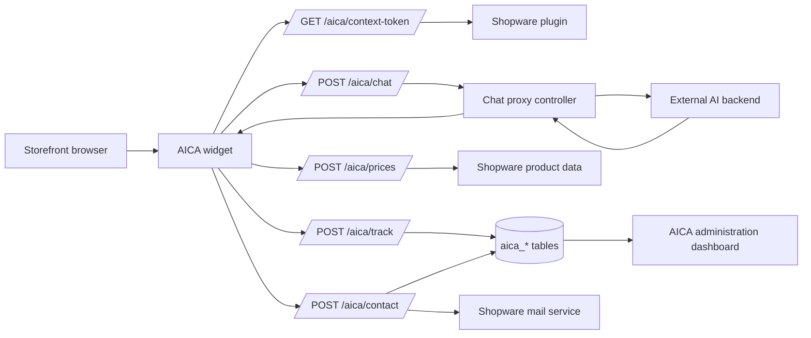

# Architecture

AICA keeps storefront integration and commerce-specific behavior inside Shopware while delegating natural-language response generation to an external AI backend.

## Storefront widget

The storefront integration is injected through `src/Resources/views/storefront/page/content/index.html.twig`. It renders a `data-aica-root` element with data attributes consumed by the storefront JavaScript plugin registered as `AicaPlugin`.

The widget renders:

- Plain assistant messages
- Structured response blocks
- Product suggestion lists
- Info boxes
- Contact escalation forms

## Shopware controller and proxy layer

Browser requests use Shopware routes under `/aica/...`. The chat proxy receives `/aica/chat` requests, reads `AiCommerceAssistant.config.chatUrl`, normalizes the backend URL, and forwards the JSON payload to the external AI backend.

The external backend remains responsible for generating the assistant response. Shopware remains responsible for storefront integration, product prices, contact handling, tracking, and administration analytics.

## Context-token endpoint

`/aica/context-token` creates a short-lived signed context token using `CHAT_AUTH_SECRET`. The token includes the storefront session identifier and sales channel context needed by the external backend.

The endpoint expects trusted AJAX requests marked with `X-AICA: 1`.

## Product price endpoint

`/aica/prices` enriches assistant product suggestions with Shopware product pricing. Visibility and price source behavior are controlled by:

- `AiCommerceAssistant.config.productPriceVisibility`
- `AiCommerceAssistant.config.productPriceMode`
- `AiCommerceAssistant.config.showProductPriceHint`

## Tracking and persistence

`/aica/track` stores chat/session metadata for analytics. The plugin defines custom DAL entities and tables with the `aica_` prefix:

- `aica_chat_session`
- `aica_chat_message`
- `aica_contact_submission`
- `aica_product_reference`

## Contact escalation

Structured assistant responses can render a contact form. The form posts to `/aica/contact`, which validates the submission, stores contact metadata, and sends internal/customer mails according to plugin configuration.

## Administration analytics

The administration module is registered as `aica`. It uses API routes under `/api/_action/aica/dashboard/...` to show analytics, list sessions, inspect messages, export data, and delete tracked sessions or contacts where ACL permissions allow it.
